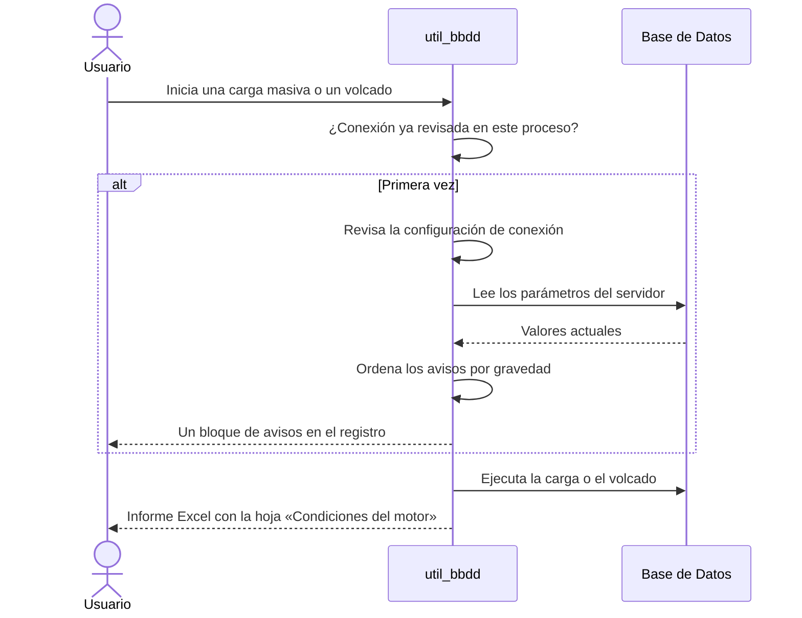

# Condiciones del Motor

## 1. Descripción General

Antes de una carga o un volcado masivo, la librería revisa la configuración de conexión y la del servidor de base de
datos y avisa de lo que puede frenar la operación o ponerla en riesgo: un pool de conexiones pequeño, tiempos de espera
cortos, un servidor con poca memoria para ordenar o un modo de escritura que pierde transacciones si el servidor cae.
Cada aviso lleva un nivel de gravedad y una recomendación en texto para quien administra el servidor.

La revisión es solo de lectura: no cambia nada en el servidor ni detiene la operación. Se hace sola, una vez por
conexión, al empezar una carga masiva o un volcado, y su resultado aparece en el registro de la aplicación, en la
documentación de la base de datos y en los informes Excel de auditoría y de volcado. También se puede pedir a mano.

**Precondiciones:**

| Requisito | Detalle |
|---|---|
| Motor con revisión | MySQL, MariaDB, PostgreSQL, SQL Server, Oracle o SQLite. HSQLDB no tiene revisión |
| Parámetros de conexión | Bastan para la revisión de la configuración, sin conectar |
| Conexión activa | Solo para revisar los parámetros del servidor; sin ella se revisa solo la configuración |
| Permisos de lectura | Leer los parámetros del servidor no exige ser administrador; en Oracle, si no se pueden leer, se avisa y se sigue |

## 2. Reglas de Negocio

| Regla | Descripción | Impacto si se viola |
|---|---|---|
| Cuatro niveles de gravedad | `OK` (adecuado), `INFO` (mejora sugerida), `WARNING` (por debajo de lo recomendado) y `CRITICAL` (valor no válido) | Sin niveles, un aviso menor y un riesgo real se verían igual |
| Peor primero | Los avisos se presentan de mayor a menor gravedad | Los problemas importantes quedarían enterrados entre los correctos |
| Nunca bloquea | Un fallo al leer un parámetro omite solo ese aviso; un fallo de la propia revisión deja un aviso y la operación sigue | Una revisión opcional detendría una carga válida |
| Una vez por conexión | La revisión automática se hace la primera vez que se usa cada conexión en el proceso, también con varios hilos a la vez | Cada lote de una carga repetiría la consulta al servidor y llenaría el registro |
| Solo lo configurado | Solo se revisan los parámetros que el usuario ha fijado y que el motor conoce | Avisos sobre opciones que el usuario no usa |
| Valor no válido, aviso crítico | Un parámetro con un valor que no se puede interpretar (`pool_size="abc"`) da un aviso crítico para ese parámetro, y la revisión del resto sigue | Un error de configuración pasaría desapercibido o impediría revisar lo demás |
| Credenciales protegidas | La contraseña nunca aparece en el registro ni en la descripción de la conexión | Las contraseñas acabarían en logs e informes |
| «Sin avisos» no es «sin revisar» | El resultado indica si el motor tiene revisión, si se pudo conectar y, si no, por qué | Un informe vacío se leería como que todo está bien |

## 3. Casos de Uso

### Flujo principal

### Flujos alternativos

**Revisión a mano:** el usuario pide el informe de condiciones de un gestor de conexión, o revisa unos parámetros de
conexión sin conectar, para validar una configuración antes de usarla.

**Sin conexión:** si no se puede conectar, se revisa solo la configuración y el resultado indica por qué no se
revisaron los parámetros del servidor.

**Motor sin revisión:** con HSQLDB el resultado está vacío y lo indica expresamente.

**Documentación de la base de datos:** la documentación en Word, Excel o HTML puede incluir una sección «Condiciones
del motor» al final.

**Límites y exclusiones:**

- No cambia ningún parámetro del servidor: las recomendaciones son texto
- No detiene ni ralentiza la carga si encuentra avisos
- No mide el rendimiento real del servidor; compara valores con umbrales recomendados
- Los umbrales por motor están en la [guía de validación de parámetros](../guides/performance_readiness_guide.md)

## 4. Criterios de Aceptación

Derivados de los tests de la revisión de condiciones (`tests/unit/connection/` y `tests/unit/bulk/`).

| ID | Dado | Cuando | Entonces |
|---|---|---|---|
| AC-01 | PostgreSQL con `pool_size` igual a 2, 10 o 25 | Se revisa la configuración | El aviso de `pool_size` es `WARNING`, `OK` e `INFO` respectivamente |
| AC-02 | Avisos de distinta gravedad | Se revisa | Se devuelven del más grave al menos grave |
| AC-03 | `pool_size="abc"` | Se revisa la configuración | Aviso `CRITICAL` para `pool_size` y el resto se revisa igual |
| AC-04 | Una conexión que falla al leer los parámetros del servidor | Se revisa | No se lanza ningún error |
| AC-05 | Varias cargas masivas sobre la misma conexión, también en hilos paralelos | Se crean | Hay un único bloque de avisos en el registro |
| AC-06 | Dos conexiones distintas al mismo servidor | Se revisan | Cada una se revisa por separado |
| AC-07 | Una revisión ya hecha y una petición del informe de esa conexión | Se pide el informe | Se devuelve el guardado, sin conectar de nuevo |
| AC-08 | Un servidor al que no se puede conectar | Se pide el informe | Contiene la revisión de la configuración y el tipo de error, sin su mensaje |
| AC-09 | `conn_params` con contraseña | Se escribe el bloque en el registro | La contraseña no aparece |
| AC-10 | SQLite en fichero con modo de diario `delete` | Se revisa con conexión | Aviso `WARNING` para `journal_mode`; con `wal`, `OK`. En memoria no se revisa |
| AC-11 | Un volcado con origen y destino distintos | Termina | El informe Excel acaba con un bloque de condiciones por cada uno; si son la misma conexión, un solo bloque |
| AC-12 | Una revisión que falla durante un volcado | Se ejecuta el volcado | El volcado termina igualmente |

## 5. Glosario y Términos

| Término | Definición |
|---|---|
| Condiciones del motor | Configuración de conexión y parámetros del servidor que influyen en una carga masiva |
| Aviso (hallazgo) | Resultado de revisar un parámetro: nivel, valor actual y recomendación |
| Revisión estática | La que usa solo los parámetros de conexión, sin conectar |
| Revisión dinámica | La que lee los parámetros del servidor con una conexión activa |
| Pool de conexiones | Conjunto de conexiones abiertas que se reutilizan entre operaciones |
| Modo de diario (SQLite) | Forma en que SQLite registra los cambios; `wal` permite leer mientras otro escribe |
