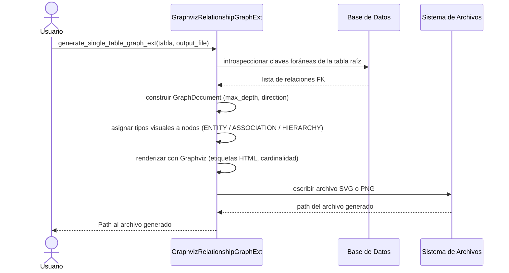

# Análisis y Visualización de Relaciones

## Objetivo de negocio

Genera representaciones visuales del esquema relacional de una base de datos: cada tabla y
sus relaciones con otras tablas (vía claves foráneas) se representan como un grafo donde los
nodos son tablas y las aristas son relaciones entre ellas.

Útil para documentar la estructura de una base de datos, identificar dependencias entre
entidades y generar diagramas exportables a SVG, PNG u otros formatos gráficos.

Soporta dos motores de visualización:

- **Graphviz** (`GraphvizRelationshipGraphExt`): nodos con columnas y cardinalidad, alta resolución.
- **Matplotlib** (`MatplotlibRelationshipGraph`): layout radial con NetworkX, dependencias más ligeras.

## Precondiciones

- `SyncDatabaseManager` configurado y conectado a la base de datos que se desea analizar.
- Para Graphviz: binarios de Graphviz instalados en el sistema (`dot` en PATH) y paquete Python `graphviz`.
- Para Matplotlib: paquetes `matplotlib` y `networkx` instalados.
- Extra de instalación: `pip install util_bbdd[analysis]`.
- Las tablas analizadas deben tener claves foráneas definidas para que aparezcan relaciones en el grafo.

## Flujo principal del usuario



## Reglas de negocio críticas

| Regla | Descripción | Impacto si se viola |
|---|---|---|
| `max_depth` controla la profundidad | Solo se incluyen tablas hasta `max_depth` saltos desde la raíz | Profundidades altas generan grafos ilegibles |
| `direction` filtra el sentido | `OUTGOING` muestra tablas hijas; `INCOMING` tablas padre; `BOTH` ambas | Dirección incorrecta oculta parte del esquema |
| Paginación automática | Si una tabla supera `max_subnodes` relaciones se generan múltiples imágenes | Sin paginación, un grafo único sería ilegible |
| Graphviz requiere binarios del sistema | Sin el ejecutable `dot` en PATH la generación falla con error | `DocumentationRenderError` o `FileNotFoundError` |
| Los tipos visuales se asignan por heurística | Tablas con dos FK y pocas columnas propias → `ASSOCIATION`; resto → `ENTITY` | Clasificación incorrecta cambia el color del nodo |

## Ejemplo de funcionamiento

```python
from pathlib import Path
from util_bbdd import SyncDatabaseManager
from util_bbdd.analysis import GraphvizRelationshipGraphExt, LevelDirection

manager = SyncDatabaseManager(...)

grafo = GraphvizRelationshipGraphExt(
    db_manager=manager,
    max_depth=2,
    direction=LevelDirection.BOTH,
    column_mode="relations",   # mostrar solo columnas relacionadas
)

# Generar imagen de una tabla específica
path = grafo.generate_single_table_graph_ext(
    table_name="pedidos",
    output_file=Path("out/pedidos.svg"),
    format="svg",
)
# path → Path("out/pedidos.svg")

# Generar grafos de todas las tablas con relaciones
resultados = grafo.generate_all_tables_graphs_ext(
    output_dir=Path("out/grafos/"),
    format="png",
    skip_tables_without_relations=True,
)
# resultados → {"pedidos": {"files": [Path(...)], "error": None}, ...}
```

## Límites y exclusiones

- Solo analiza relaciones definidas como claves foráneas; no infiere relaciones lógicas.
- No soporta gestores asíncronos; requiere `SyncDatabaseManager`.
- `MatplotlibRelationshipGraph` no muestra columnas ni cardinalidad en los nodos.
- No genera documentación HTML ni Word; para eso existe el módulo `doc`.
- Los binarios de Graphviz del sistema operativo no se instalan con `pip install util_bbdd[analysis]`.
