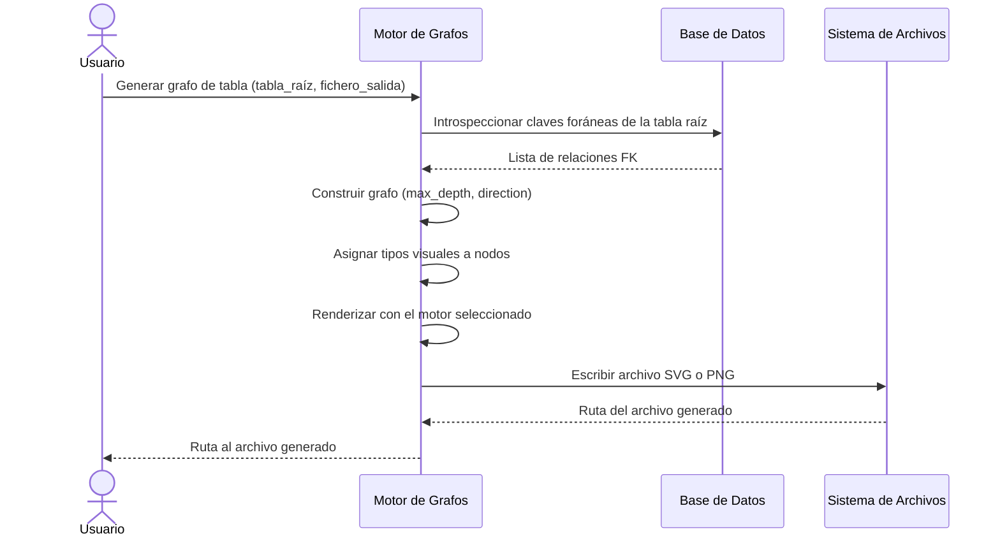

# Análisis y Visualización de Relaciones

## 1. Descripción General

Genera representaciones visuales del esquema relacional de una base de datos: cada tabla y sus relaciones con otras tablas (vía claves foráneas) se representan como un grafo donde los nodos son tablas y las aristas son relaciones entre ellas.

Útil para documentar la estructura de una base de datos, identificar dependencias entre entidades y generar diagramas exportables a SVG, PNG u otros formatos gráficos.

Soporta dos motores de visualización: Graphviz (nodos con columnas y cardinalidad, alta resolución) y Matplotlib (layout radial con NetworkX, dependencias más ligeras).

**Precondiciones:**

- Gestor síncrono de BD configurado y conectado a la base de datos a analizar
- Para Graphviz: binarios de Graphviz instalados en el sistema (`dot` en PATH) y paquete Python `graphviz`
- Para Matplotlib: paquetes `matplotlib` y `networkx` instalados
- Extra de instalación: `pip install "util_bbdd[analysis] @ git+https://github.com/fmanza/util_bbdd.git@v5.1.0"` (ver [Instalación](../installation.md))
- Las tablas analizadas deben tener claves foráneas definidas para que aparezcan relaciones en el grafo

## 2. Reglas de Negocio

| Regla | Descripción | Impacto si se viola |
|---|---|---|
| `max_depth` controla la profundidad | Solo se incluyen tablas hasta `max_depth` saltos desde la raíz | Profundidades altas generan grafos ilegibles |
| `direction` filtra el sentido | `OUTGOING` muestra tablas hijas; `INCOMING` tablas padre; `BOTH` ambas | Dirección incorrecta oculta parte del esquema |
| Paginación automática | Si una tabla supera el límite de relaciones se generan múltiples imágenes | Sin paginación, un grafo único sería ilegible |
| Graphviz requiere binarios del sistema | Sin el ejecutable `dot` en PATH la generación falla con error | Error de renderización o fichero no encontrado |
| Los tipos visuales se asignan por heurística | Tablas con dos FK y pocas columnas propias se clasifican como tabla de asociación; resto como entidad | Clasificación incorrecta cambia el color del nodo |

## 3. Casos de Uso

### Flujo principal

### Flujos alternativos

**Generación de todas las tablas:** El módulo permite generar grafos de todas las tablas con relaciones en un directorio de salida, con la opción de omitir tablas sin relaciones FK.

**Motor Matplotlib:** Para entornos donde Graphviz no está disponible, el motor Matplotlib genera un layout radial más simple sin columnas ni cardinalidad en los nodos.

**Límites y exclusiones:**

- Solo analiza relaciones definidas como claves foráneas; no infiere relaciones lógicas
- No soporta gestores asíncronos; requiere el gestor síncrono de BD
- El motor Matplotlib no muestra columnas ni cardinalidad en los nodos
- No genera documentación HTML ni Word
- Los binarios de Graphviz del sistema operativo no se instalan con el extra `analysis`

## 4. Criterios de Aceptación

Derivados de los tests del análisis de relaciones.

| ID | Dado | Cuando | Entonces |
|---|---|---|---|
| AC-01 | Una tabla con una tabla padre y dos niveles de tablas hijas | Se construye su grafo con `max_depth=2` y `direction=BOTH` | Se incluyen las relaciones de ambos sentidos y no queda ningún nivel oculto |
| AC-02 | Dos niveles de tablas hijas y `max_depth=1` | Se construye el grafo entrante | Solo se incluye el primer nivel y se informa de un nivel oculto |
| AC-03 | Tablas con claves foráneas en ciclo | Se construye el grafo | Termina sin recursión infinita e incluye las relaciones del ciclo |
| AC-04 | Una tabla con dos claves foráneas y sin columnas propias | Se construye el grafo | Se clasifica como tabla de asociación y sus tablas padre como entidades |
| AC-05 | Una tabla con más relaciones que el máximo por imagen | Se reparten para dibujarlas | Se generan varios bloques equilibrados que conservan el orden de las relaciones |
| AC-06 | La generación de una tabla falla durante la generación de todas las tablas | Termina el lote | Esa tabla queda con estado `error` y su mensaje; las demás terminan en `success` |

## 5. Glosario y Términos

| Término | Definición |
|---|---|
| Grafo relacional | Representación visual donde cada nodo es una tabla y cada arista es una relación de clave foránea entre dos tablas |
| `max_depth` | Número máximo de saltos de clave foránea desde la tabla raíz hasta las tablas incluidas en el grafo |
| Cardinalidad | Tipo de relación entre dos tablas (uno a uno, uno a muchos, muchos a muchos) representada visualmente en las aristas del grafo |
| Tabla de asociación | Tabla con dos o más claves foráneas y pocas columnas propias, que representa una relación muchos-a-muchos |
