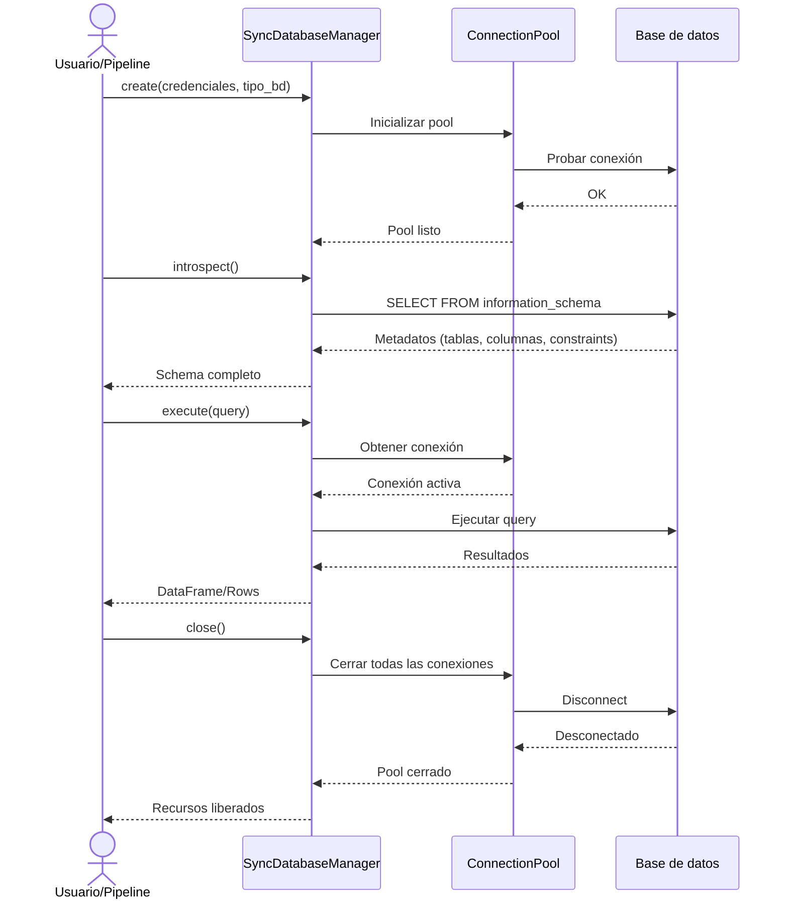

# Ciclo de vida de sesión sincrónica - SyncDatabaseManager

## Objetivo de negocio

El gestor sincrónico de base de datos (`SyncDatabaseManager`) resuelve el problema crítico de **gestionar conexiones a múltiples tipos de bases de datos de forma segura y consistente**, sin que el usuario final tenga que conocer los detalles técnicos de cada motor específico (PostgreSQL, MySQL, Oracle, Snowflake, etc.).

Su valor principal es **abstraer la complejidad** de autenticación, configuración, reconexión y limpieza de recursos, permitiendo que aplicaciones y pipelines de análisis se enfoquen en la lógica de negocio.

## Precondiciones

Antes de usar `SyncDatabaseManager`, se requiere:

1. **Credenciales de base de datos** válidas (usuario, contraseña, host, puerto, base de datos)
2. **Tipo de base de datos identificado** (PostgreSQL, MySQL, Oracle, SQLite, SQL Server, Redshift, Snowflake, MariaDB, HSQLDB)
3. **Conectividad de red** hacia el servidor de base de datos (si es remoto)
4. **Configuración de pool de conexiones** (opcional; se proporcionan defaults)
5. **Permisos de base de datos** mínimos: SELECT sobre information_schema/pg_catalog (para introspeção)

## Flujo principal del usuario



## Reglas de negocio críticas

| Regla | Descripción | Impacto si se viola |
|-------|-----------|-------------------|
| **Una sesión, un tipo de BD** | Cada instancia de `SyncDatabaseManager` se vincula a un único tipo de base de datos durante su ciclo de vida | Inconsistencias en tipos de datos, errores de query parsing |
| **Cierre explícito obligatorio** | Llamar a `close()` al terminar, o usar context manager (`with`) | Memory leaks, conexiones huérfanas, bloqueos en base de datos |
| **Pool predeterminado seguro** | El pool tiene límites de conexiones (típicamente 5-20) y timeout de reconexión | Agotamiento de conexiones, timeouts en aplicación de bajo rendimiento |
| **Introspeção sin modificación** | La operación `introspect()` es de solo lectura | N/A (es una garantía del sistema) |
| **Una sola conexión activa por request** | El manager no paraleliza requests; usa una cola de espera | Posibles errores de transacción si se ignora |

## Ejemplo de funcionamiento

```python
from util_bbdd.managers import SyncDatabaseManager

# 1. Crear gestor con credenciales
manager = SyncDatabaseManager(
    db_type="postgresql",
    host="localhost",
    port=5432,
    user="analyst",
    password="secret",
    database="mydb"
)

# 2. Introspeccionar esquema
schema = manager.introspect()
print(f"Tablas encontradas: {len(schema.tables)}")
for table in schema.tables:
    print(f"  - {table.name}: {len(table.columns)} columnas")

# 3. Ejecutar query simple
rows = manager.execute("SELECT COUNT(*) as total FROM users")
print(f"Total usuarios: {rows[0]['total']}")

# 4. Cerrar conexión
manager.close()
```

**Usando context manager (recomendado)**:

```python
with SyncDatabaseManager(db_type="mysql", ...) as manager:
    schema = manager.introspect()
    users = manager.execute("SELECT * FROM users LIMIT 10")
    # Cierre automático al salir del bloque
```

## Límites y exclusiones

- ❌ **No soporta transacciones distribuidas** (multi-BD en una sola transacción)
- ❌ **No paraleliza queries** (una conexión = una query a la vez)
- ❌ **No cachea resultados** (cada `execute()` consulta la BD)
- ❌ **No soporta modificación de esquema** (DDL como CREATE TABLE no es recomendado)
- ❌ **No valida credenciales en tiempo de inicialización** (se validan en la primera operación)

---

*Generado por Documentation Generator - Fase 2: Mapeo Funcional*
