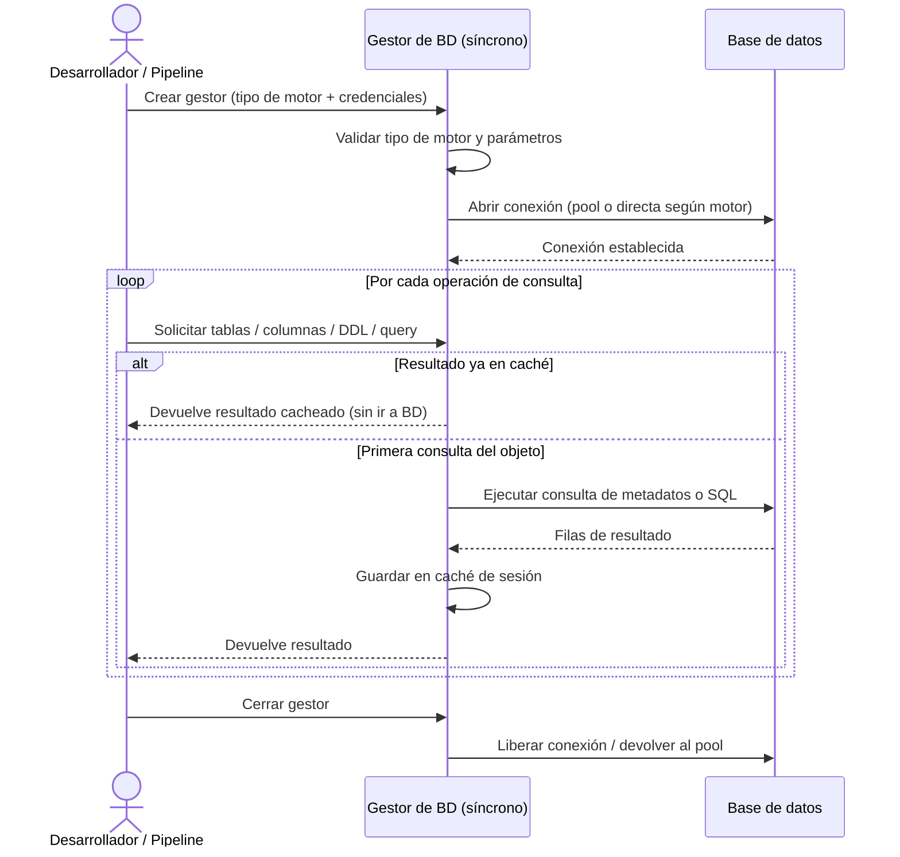

## Objetivo de negocio

Permite conectar a cualquiera de los motores de base de datos habituales en una organización — MariaDB, Oracle, PostgreSQL, SQLite, HSQLDB y SQL Server — con una única forma de trabajo, sin cambiar el código según el motor utilizado. El responsable de datos o el desarrollador configura el tipo de base de datos y las credenciales una sola vez; a partir de ahí puede listar tablas, obtener columnas, leer índices, consultar el DDL de cualquier objeto y ejecutar consultas propias, sin conocer los dialectos internos de cada motor.

Las consultas repetidas al mismo objeto no vuelven a la base de datos durante la sesión: el gestor mantiene una caché interna que reduce la carga sobre los servidores en flujos de introspección intensivos o en generación de documentación de esquemas.

## Precondiciones

- Servidor de base de datos accesible en red (host, puerto y credenciales válidas)
- Driver Python del motor instalado en el entorno (`pyodbc` para SQL Server, `cx_Oracle` para Oracle, `psycopg2` para PostgreSQL, `mariadb` para MariaDB, etc.)
- Tipo de motor declarado explícitamente al crear el gestor: `mariadb`, `oracle`, `postgresql`, `sqlite`, `hsqldb` o `sqlserver`
- Parámetros de conexión mínimos: `database` (requerido en todos los motores), más los específicos del motor (`host`, `port`, `user`, `password`)
- Para Oracle: disponibilidad de Oracle Instant Client si se usa conexión nativa

## Flujo principal del usuario

## Reglas de negocio críticas

| Regla | Descripción | Impacto si se viola |
|---|---|---|
| `database` obligatorio | El nombre de la base de datos debe estar presente en los parámetros de conexión | Error de configuración al inicializar; el gestor no se crea |
| Tipo de motor válido | El tipo de BD debe coincidir exactamente con uno de los seis soportados | Error de validación en inicio; la conexión no se intenta |
| Driver instalado | El driver Python del motor debe estar disponible en el entorno de ejecución | Error de driver en tiempo de inicialización; sin fallback automático a otro driver |
| Pool con fallback automático | Si el motor no admite pool de conexiones, el gestor usa conexión directa sin interrupción | Advertencia en log, pero la operación continúa; sin pérdida de datos |
| Caché por sesión | Los metadatos se cachean en memoria durante toda la vida del gestor | Cambios en la BD realizados por otros procesos durante la sesión no se reflejan; es necesario reiniciar el gestor para obtener datos actualizados |
| Cierre explícito requerido | Si el gestor no se cierra correctamente, las conexiones del pool permanecen abiertas | Agotamiento del pool de conexiones en el servidor de BD; el destructor intenta cerrar como último recurso pero no está garantizado |

## Límites y exclusiones

- No admite operaciones asíncronas: para código `async/await` utilizar el gestor asíncrono equivalente
- No realiza inserción, actualización ni borrado masivo de datos: esas operaciones corresponden al módulo de operaciones bulk
- No genera documentación de esquemas en ningún formato: esa funcionalidad pertenece al módulo de documentación de BD
- No compara esquemas entre dos bases de datos distintas: para eso existe el módulo de comparación de esquemas
- No soporta Snowflake ni Redshift en la modalidad síncrona: solo los seis motores declarados (MariaDB, Oracle, PostgreSQL, SQLite, HSQLDB, SQL Server)
