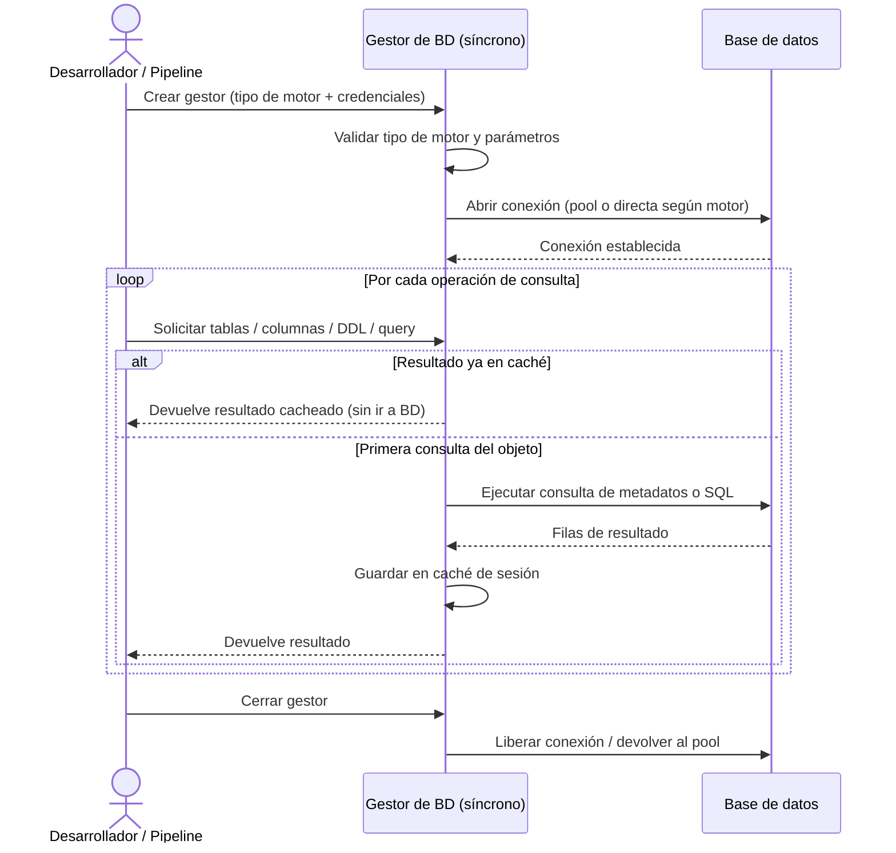

# Gestión de Conexiones (Síncrono)

## 1. Descripción General

Permite conectar a cualquiera de los motores de base de datos habituales en una organización — MariaDB, Oracle, PostgreSQL, SQLite, HSQLDB y SQL Server — con una única forma de trabajo, sin cambiar el código según el motor utilizado. El responsable de datos o el desarrollador configura el tipo de base de datos y las credenciales una sola vez; a partir de ahí puede listar tablas, obtener columnas, leer índices, consultar el DDL de cualquier objeto y ejecutar consultas propias, sin conocer los dialectos internos de cada motor.

Las consultas repetidas al mismo objeto no vuelven a la base de datos durante la sesión: el gestor mantiene una caché interna que reduce la carga sobre los servidores en flujos de introspección intensivos o en generación de documentación de esquemas.

**Precondiciones:**

- Servidor de base de datos accesible en red (host, puerto y credenciales válidas)
- Driver Python del motor instalado en el entorno (`pyodbc` para SQL Server, `oracledb` para Oracle, `psycopg` (v3) y `psycopg-pool` para PostgreSQL (`pip install "util_bbdd[postgresql]"`), `mariadb` (Connector/Python) para MariaDB, `pymysql` para MySQL, etc.)
- Tipo de motor declarado explícitamente: `mariadb`, `oracle`, `postgresql`, `sqlite`, `hsqldb` o `sqlserver`
- Parámetros de conexión mínimos: `database` (requerido en todos los motores)
- Para Oracle: disponibilidad de Oracle Instant Client si se usa conexión nativa

## 2. Reglas de Negocio

| Regla | Descripción | Impacto si se viola |
|---|---|---|
| `database` obligatorio | El nombre de la base de datos debe estar presente en los parámetros de conexión | Error de configuración al inicializar; el gestor no se crea |
| Tipo de motor válido | El tipo de BD debe coincidir exactamente con uno de los seis soportados | Error de validación en inicio; la conexión no se intenta |
| Driver instalado | El driver Python del motor debe estar disponible en el entorno de ejecución | Error de driver en tiempo de inicialización; sin fallback automático |
| Pool con fallback automático | Si el motor no admite pool de conexiones, el gestor usa conexión directa sin interrupción | Advertencia en log, pero la operación continúa; sin pérdida de datos |
| Caché por sesión | Los metadatos se cachean en memoria durante toda la vida del gestor | Cambios en la BD realizados por otros procesos durante la sesión no se reflejan |
| Cierre explícito requerido | Si el gestor no se cierra correctamente, las conexiones del pool permanecen abiertas | Agotamiento del pool de conexiones en el servidor de BD |

## 3. Casos de Uso

### Flujo principal

### Flujos alternativos

**Uso como context manager (recomendado):** El gestor puede usarse con `with`, lo que garantiza el cierre automático de la conexión al salir del bloque, incluso si se produce una excepción.

**Motor sin pool:** Algunos motores no admiten pool de conexiones. El gestor detecta esta situación automáticamente y usa una conexión directa, registrando una advertencia en el log.

**Límites y exclusiones:**

- No admite operaciones asíncronas: para código `async/await` utilizar el gestor asíncrono equivalente
- No realiza inserción, actualización ni borrado masivo de datos: esas operaciones corresponden al módulo de operaciones bulk
- No genera documentación de esquemas en ningún formato
- No compara esquemas entre dos bases de datos distintas
- Solo los motores declarados (MariaDB, MySQL, Oracle, PostgreSQL, SQL Server, SQLite y HSQLDB)

## 4. Glosario y Términos

| Término | Definición |
|---|---|
| Pool de conexiones | Conjunto de conexiones a la BD mantenidas abiertas y reutilizadas para evitar el coste de abrir/cerrar por cada operación |
| Context manager | Patrón Python (`with gestor:`) que garantiza que el método `close()` se llame automáticamente al salir del bloque |
| Caché de sesión | Almacenamiento en memoria de metadatos consultados durante la sesión, para evitar viajes repetidos a la BD |
