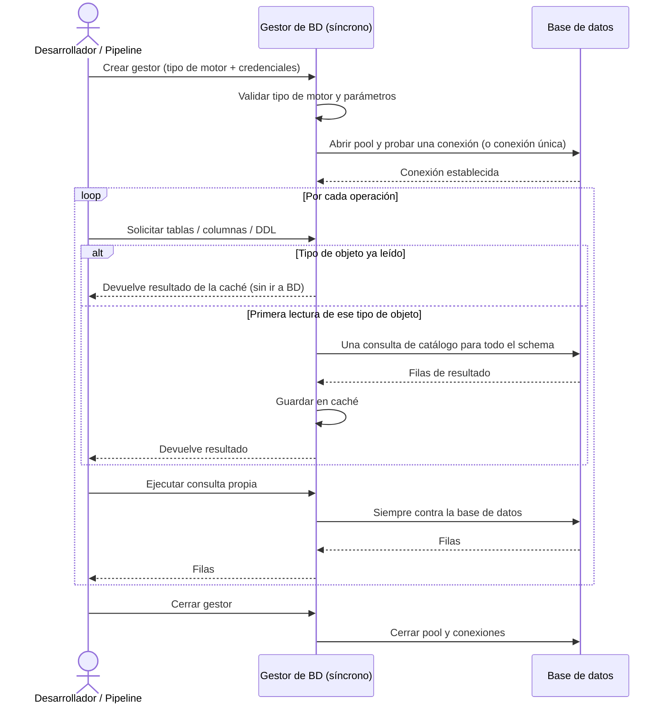

# Gestión de Conexiones (Síncrono)

## 1. Descripción General

Permite conectar a cualquiera de los motores soportados — MariaDB, MySQL, Oracle, PostgreSQL, SQL Server, SQLite y
HSQLDB — con una única forma de trabajo, sin cambiar el código según el motor utilizado. El responsable de datos o el
desarrollador configura el tipo de base de datos y las credenciales una sola vez; a partir de ahí puede listar tablas,
obtener columnas, leer índices, consultar el DDL de cualquier objeto y ejecutar consultas propias, sin conocer los
dialectos internos de cada motor.

Los metadatos se leen por lotes (una consulta por tipo de objeto para todo el schema) y se guardan en una caché del
gestor: pedir las columnas de otra tabla no vuelve a la base de datos. Esto reduce la carga sobre los servidores en
flujos de introspección intensivos o en generación de documentación de esquemas.

**Precondiciones:**

- Servidor de base de datos accesible en red (salvo SQLite)
- Driver Python del motor instalado en el entorno: `mariadb` (Connector/Python) para MariaDB y `pymysql` para MySQL
  (extras `mariadb` / `mysql`), `psycopg` (v3) y `psycopg-pool` para PostgreSQL (extra `postgresql`), `oracledb` para
  Oracle (extra `oracle`), `pymssql` para SQL Server (o `pyodbc` con `sql_server_driver="pyodbc"`),
  `jaydebeapi` y Java para HSQLDB. Instalación con extras:
  `pip install "util_bbdd[postgresql] @ git+https://github.com/fmanza/util_bbdd.git@v5.0.0"`
- Tipo de motor declarado explícitamente: `mariadb`, `mysql`, `oracle`, `postgresql`, `sqlserver`, `sqlite` o `hsqldb`
- Parámetros de conexión obligatorios del motor: `host`, `user`, `password` y `database` (MariaDB, MySQL, PostgreSQL,
  SQL Server); `user` y `password` (Oracle); `user`, `jdbc_url` y `jdbc_jar` (HSQLDB); `database` (SQLite)
- Oracle: Oracle Instant Client solo si se activa el modo thick (`oracle_thick_mode=True` + `oracle_client_path`); el
  modo por defecto (thin) no lo necesita
- Permisos de lectura sobre el catálogo del sistema para la introspección

## 2. Reglas de Negocio

| Regla | Descripción | Impacto si se viola |
|---|---|---|
| Parámetros obligatorios | Cada motor exige sus parámetros de conexión (ver precondiciones) | Error de validación al inicializar; el gestor no se crea |
| Tipo de motor válido | El tipo de BD debe ser uno de los siete soportados (sin distinguir mayúsculas) | Error de validación en inicio; la conexión no se intenta |
| Una instancia, un motor | Cada gestor queda ligado a un único tipo de base de datos durante toda su vida | Para otro motor hay que crear otro gestor |
| Driver instalado | El driver Python del motor debe estar disponible en el entorno de ejecución | Error de driver en tiempo de inicialización; sin fallback automático |
| Conexión comprobada al crear | Con pool, el gestor pide y devuelve una conexión de prueba al inicializarse | Credenciales o servidor incorrectos fallan al crear el gestor, no en la primera consulta |
| Motor sin pool | HSQLDB no tiene pool: el gestor usa una conexión única | Advertencia en log; la operación continúa |
| Caché de metadatos | Los metadatos se cachean durante toda la vida del gestor; las consultas propias (`execute_*`) no se cachean nunca | Cambios de esquema hechos por otros procesos no se ven hasta invalidar la caché (`clear_cache()`) |
| Cierre explícito requerido | Si el gestor no se cierra, las conexiones del pool permanecen abiertas | Agotamiento de conexiones en el servidor de BD |

## 3. Casos de Uso

### Flujo principal

### Flujos alternativos

**Uso como context manager (recomendado):** El gestor puede usarse con `with`, lo que garantiza el cierre automático
de la conexión al salir del bloque, incluso si se produce una excepción.

**Motor sin pool:** HSQLDB no admite pool de conexiones. El gestor lo detecta y usa una conexión única, registrando una
advertencia en el log. Con `use_pool=False` se fuerza la conexión única en cualquier motor.

**Límites y exclusiones:**

- No admite operaciones asíncronas: para código `async/await` utilizar el gestor asíncrono equivalente
- No realiza inserción, actualización ni borrado masivo de datos: esas operaciones corresponden al módulo de operaciones bulk
- No genera documentación de esquemas ni compara esquemas (módulos de documentación y de comparación)
- No coordina transacciones entre varias bases de datos
- Solo los motores declarados (MariaDB, MySQL, Oracle, PostgreSQL, SQL Server, SQLite y HSQLDB)

## 4. Criterios de Aceptación

Derivados de los tests del gestor y comprobados contra el código.

| ID | Dado | Cuando | Entonces |
|---|---|---|---|
| AC-01 | Un tipo de motor que no es ninguno de los siete soportados | Se crea el gestor | Se rechaza con un error de validación (`InvalidDatabaseType`) que lista los tipos soportados; no se intenta conectar |
| AC-02 | Falta un parámetro obligatorio del motor (p. ej. `database`) | Se crea el gestor | Se rechaza con un error de validación que nombra el parámetro que falta |
| AC-03 | Se han leído las tablas de un schema | Se vuelven a pedir | Se devuelven las mismas sin volver a consultar la base de datos |
| AC-04 | Se crea una tabla con una consulta propia después de leer los metadatos | Se piden las tablas sin y con `clear_cache()` | Sin invalidar no aparece; tras `clear_cache()` aparece |
| AC-05 | Se leyeron solo algunos tipos de objeto (p. ej. columnas) | Se pide un tipo que no se cargó | Error explícito de tipo no cargado, nunca una lista vacía |
| AC-06 | El cierre de uno de los recursos (pool, cursor o conexión) falla | Se cierra el gestor | Se intenta cerrar el resto, el gestor queda sin recursos y el fallo se informa como error de operación |
| AC-07 | Se pide el engine SQLAlchemy varias veces | Se cierra el gestor | Se reutilizó un único engine y se libera al cerrar |

## 5. Glosario y Términos

| Término | Definición |
|---|---|
| Sesión | Período de vida de una instancia del gestor, desde su creación hasta el cierre |
| Pool de conexiones | Conjunto de conexiones a la BD mantenidas abiertas y reutilizadas para evitar el coste de abrir/cerrar por cada operación |
| Context manager | Patrón Python (`with gestor:`) que garantiza que el método `close()` se llame automáticamente al salir del bloque |
| Caché de metadatos | Snapshot en memoria del catálogo por schema y tipo de objeto, para evitar viajes repetidos a la BD |
