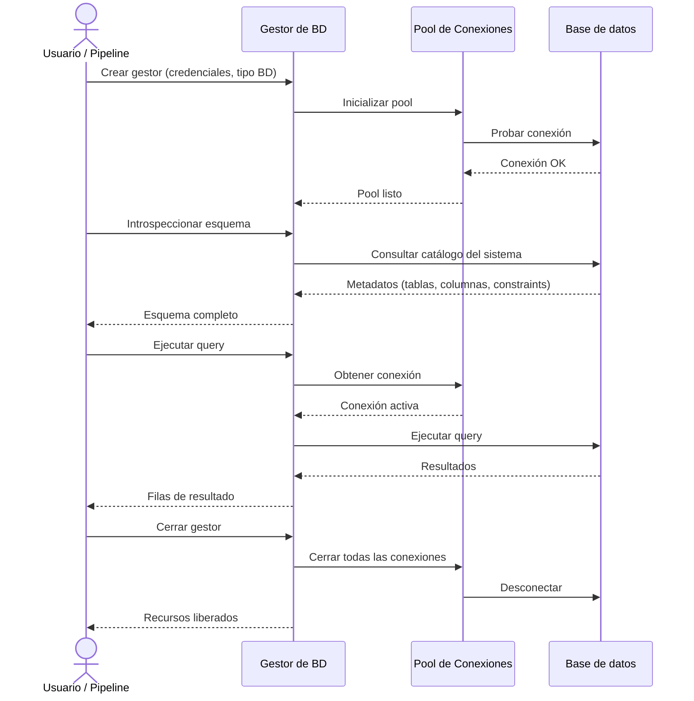

# Ciclo de Vida de Sesión Sincrónica

## 1. Descripción General

El gestor sincrónico de base de datos resuelve el problema crítico de gestionar conexiones a múltiples tipos de bases de datos de forma segura y consistente, sin que el usuario final tenga que conocer los detalles técnicos de cada motor específico (PostgreSQL, MySQL, Oracle, SQL Server, etc.).

Su valor principal es abstraer la complejidad de autenticación, configuración, reconexión y limpieza de recursos, permitiendo que aplicaciones y pipelines de análisis se enfoquen en la lógica de negocio.

**Precondiciones:**

- Credenciales de base de datos válidas (usuario, contraseña, host, puerto, base de datos)
- Tipo de base de datos identificado (PostgreSQL, MySQL, Oracle, SQLite, SQL Server, MariaDB, HSQLDB)
- Conectividad de red hacia el servidor de base de datos (si es remoto)
- Configuración de pool de conexiones (opcional; se usan valores por defecto seguros)
- Permisos de base de datos mínimos: SELECT sobre los catálogos del sistema para introspección

## 2. Reglas de Negocio

| Regla | Descripción | Impacto si se viola |
|---|---|---|
| Una sesión, un tipo de BD | Cada instancia del gestor se vincula a un único tipo de base de datos durante su ciclo de vida | Inconsistencias en tipos de datos, errores de query parsing |
| Cierre explícito obligatorio | Llamar a `close()` al terminar, o usar context manager (`with`) | Fugas de memoria, conexiones huérfanas, bloqueos en base de datos |
| Pool predeterminado seguro | El pool tiene límites de conexiones y timeout de reconexión con valores por defecto seguros | Agotamiento de conexiones, timeouts en aplicación |
| Introspección sin modificación | La operación de introspección del esquema es de solo lectura | Sin impacto (es una garantía del sistema) |
| Una sola conexión activa por solicitud | El gestor no paraleliza solicitudes; usa una cola de espera | Posibles errores de transacción si se ignora este comportamiento |

## 3. Casos de Uso

### Flujo principal

### Flujos alternativos

**Uso como context manager (recomendado):** Con `with gestor:` el cierre de la conexión es automático al salir del bloque, incluso si se produce una excepción durante las operaciones.

**Límites y exclusiones:**

- No soporta transacciones distribuidas (multi-BD en una sola transacción)
- No paraleliza queries (una conexión = una query a la vez)
- No cachea resultados de datos (cada `execute()` consulta la BD)
- No soporta modificación de esquema (DDL como CREATE TABLE no es el uso recomendado)
- No valida credenciales en tiempo de inicialización (se validan en la primera operación)

## 4. Glosario y Términos

| Término | Definición |
|---|---|
| Sesión | Período de vida de una instancia del gestor, desde su creación hasta el cierre de la conexión |
| Pool de conexiones | Conjunto de conexiones a la BD mantenidas abiertas y reutilizadas para evitar el coste de abrir/cerrar por cada operación |
| Context manager | Patrón Python (`with gestor:`) que garantiza que el método `close()` se llame automáticamente al salir del bloque |
