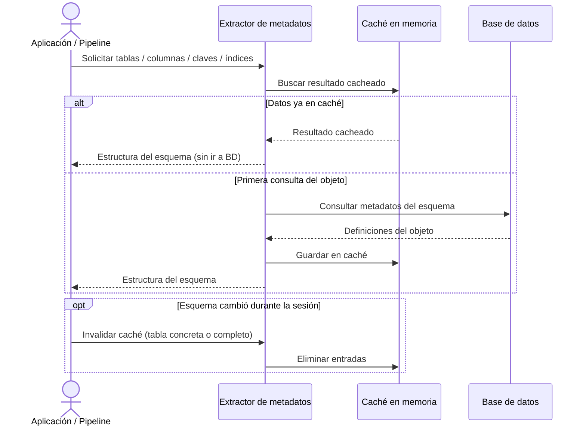

## Objetivo de negocio

Permite consultar la estructura de cualquier base de datos conectada — tablas, columnas, claves, índices — sin escribir SQL específico para cada motor. La primera consulta va a la base de datos; las siguientes se sirven desde una caché en memoria, reduciendo la carga sobre los servidores de datos en flujos de introspección repetitivos.

Es el componente que habilita a cualquier proceso automatizado (generación de documentación, comparación de esquemas, auditoría de modelos) a conocer la estructura de la BD sin intervención humana.

## Precondiciones

- Conexión activa a la base de datos, previamente configurada con las credenciales correctas
- El usuario o proceso tiene permisos de lectura sobre los metadatos del esquema (tablas del sistema, `information_schema`, catálogos del motor)
- Tipo de motor declarado: MariaDB, MySQL, PostgreSQL, Oracle, SQL Server, SQLite, Snowflake o Redshift

## Flujo principal del usuario

## Reglas de negocio críticas

| Regla | Descripción | Impacto si se viola |
|---|---|---|
| Caché por sesión | Los resultados se guardan en memoria durante la vida del extractor | Cambios de esquema realizados por otros procesos durante la sesión no se reflejan automáticamente |
| Normalización entre motores | Los metadatos se homogeneizan: misma estructura de resultado independientemente del motor | Código que dependa del formato nativo de un motor deja de ser portátil al cambiar de motor |
| Solo estructura, no datos | Consulta definiciones del esquema, no filas de las tablas | El resultado nunca contiene datos sensibles de negocio |
| Invalidación granular | El caché de una tabla concreta se puede limpiar sin reiniciar toda la sesión | Si se invalida el caché completo se incurre en coste de recarga de todos los metadatos |
| Forzar recarga puntual | Con `use_cache=False` se salta el caché y se va directamente a la BD | Mayor carga en BD; usar solo cuando se sabe con certeza que el esquema cambió |

## Límites y exclusiones

- No modifica ni crea objetos en la base de datos (no ejecuta DDL)
- No ejecuta consultas de datos de negocio: solo accede a la estructura del esquema
- No genera documentación ni informes: eso corresponde al módulo de documentación de BD
- No compara esquemas entre dos bases de datos distintas: eso corresponde al módulo de comparación
- No funciona sin una conexión activa previamente configurada
