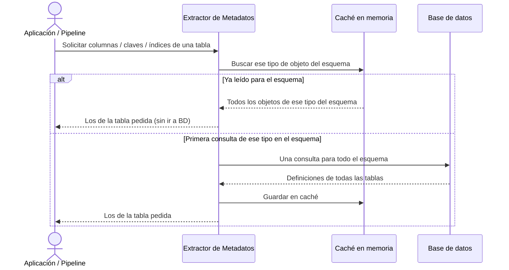

# Extracción de Metadatos

## 1. Descripción General

Permite consultar la estructura de cualquier base de datos conectada — tablas, columnas, claves, índices, rutinas — sin escribir SQL específico para cada motor. Cada tipo de objeto se lee **una sola vez para todo el esquema** (no tabla a tabla) y se guarda en una caché en memoria; las consultas siguientes, de cualquier tabla del esquema, se sirven desde ella. Documentar o comparar un esquema de cientos de tablas pasa así de miles de consultas a unas pocas decenas.

Es el componente que habilita a cualquier proceso automatizado (generación de documentación, comparación de esquemas, auditoría de modelos) a conocer la estructura de la BD sin intervención humana.

**Precondiciones:**

- Conexión activa a la base de datos, previamente configurada con las credenciales correctas
- El usuario o proceso tiene permisos de lectura sobre los metadatos del esquema (`information_schema`, catálogos del motor)
- Tipo de motor declarado: MariaDB, MySQL, PostgreSQL, Oracle, SQL Server, SQLite o HSQLDB

## 2. Reglas de Negocio

| Regla | Descripción | Impacto si se viola |
|---|---|---|
| Lectura por esquema | Cada tipo de objeto (tablas, columnas, claves, índices…) se lee con una consulta para todo el esquema | La primera lectura de un esquema muy grande trae todo el esquema; se puede limitar a unas tablas |
| Caché por esquema | Los resultados se guardan en memoria durante la vida del gestor de conexión | Cambios de esquema realizados por otros procesos durante la sesión no se reflejan automáticamente |
| Mismo resultado en todos los motores | Los metadatos llegan con la misma estructura independientemente del motor | Código que dependa del formato nativo de un motor deja de ser portátil al cambiar de motor |
| Solo estructura, no datos | Consulta definiciones del esquema, no filas de las tablas | El resultado nunca contiene datos sensibles de negocio |
| Invalidación por esquema | Limpiar la caché descarta lo leído de todo el esquema (o de todos) | La siguiente consulta vuelve a leer cada tipo de objeto del esquema |

## 3. Casos de Uso

### Flujo principal

### Flujos alternativos

**Esquema cambiado durante la sesión:** Si otro proceso modifica la BD mientras el gestor está activo, el usuario limpia la caché (del esquema afectado o completa) para obtener metadatos actualizados.

**Límites y exclusiones:**

- No modifica ni crea objetos en la base de datos (no ejecuta DDL)
- No ejecuta consultas de datos de negocio: solo accede a la estructura del esquema
- No genera documentación ni informes: eso corresponde al módulo de documentación de BD
- No compara esquemas entre dos bases de datos distintas: eso corresponde al módulo de comparación
- No funciona sin una conexión activa previamente configurada

## 4. Criterios de Aceptación

Derivados de los tests de la lectura de metadatos por lotes.

| ID | Dado | Cuando | Entonces |
|---|---|---|---|
| AC-01 | Se piden tablas y columnas de un esquema | Se leen y se vuelven a pedir | Se hace una consulta por tipo de objeto y la segunda petición no consulta la base de datos |
| AC-02 | No se indica esquema | Se leen metadatos varias veces | Se pregunta una sola vez al motor por el esquema por defecto |
| AC-03 | Solo se leyeron las tablas | Se piden las columnas de una tabla | Error explícito de tipo no cargado, nunca una lista vacía |
| AC-04 | Columnas leídas de `clientes` | Se piden como `Clientes` | Se devuelven las mismas columnas; una tabla inexistente devuelve una lista vacía |
| AC-05 | El esquema completo ya está en caché | Se piden las columnas de una sola tabla | Se sirven de la caché, sin nueva consulta, filtradas a esa tabla |
| AC-06 | Se piden más tablas de las que admite el filtro | Se leen los metadatos | Se lee el esquema completo |
| AC-07 | Se invalidó la caché de un tipo de objeto | Se vuelve a pedir | Se vuelve a consultar la base de datos |
| AC-08 | Un esquema leído con el gestor síncrono | Se leen sus metadatos con el asíncrono | Se obtienen las mismas tablas y claves foráneas |

## 5. Glosario y Términos

| Término | Definición |
|---|---|
| Metadatos | Información descriptiva sobre la estructura de la base de datos: nombres de tablas, columnas, tipos, claves e índices; no incluye datos de negocio |
| Caché de sesión | Almacenamiento en memoria que guarda, por esquema y tipo de objeto, los resultados de introspección durante la vida del gestor para evitar consultas repetidas a la BD |
| Invalidación | Acción de eliminar entradas del caché para forzar que la próxima consulta vaya directamente a la base de datos |
