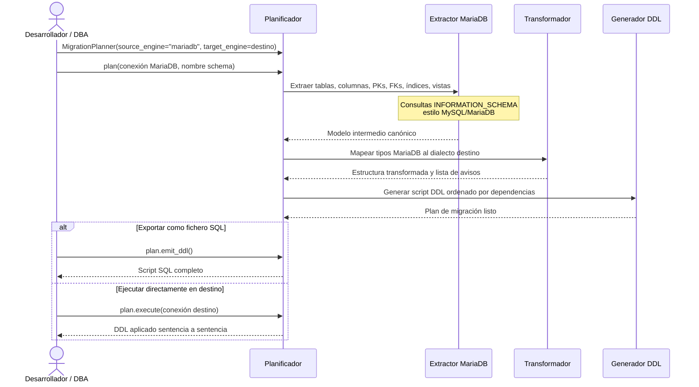

# Migración MariaDB como origen

## Objetivo de negocio

Genera automáticamente el script SQL de creación de estructura (DDL) de un schema MariaDB completo,
listo para ejecutarse en **Oracle**, **SQL Server** o **PostgreSQL**. Cubre tablas, columnas,
claves primarias, claves foráneas, índices, vistas y tipos de datos, adaptando cada elemento a
las reglas del motor destino sin modificar la base de datos origen ni la de destino hasta que el
usuario lo autorice.

Responde a la pregunta "¿cómo paso mi estructura MariaDB a otro motor sin reescribir el DDL a mano?"
de forma reproducible y auditada: cada decisión de conversión queda registrada como aviso con
nivel de severidad.

## Precondiciones

- Conexión activa al servidor MariaDB con permisos de lectura sobre `INFORMATION_SCHEMA` del schema a migrar
- Identificar el nombre del schema MariaDB que se va a migrar (equivale a `TABLE_SCHEMA`)
- Decidir el motor destino y sus parámetros específicos:

| Motor destino | Parámetro adicional | Valor por defecto |
|---|---|---|
| Oracle | — | Sin parámetros adicionales |
| SQL Server | `sql_server_collation` | Sin cláusula COLLATE explícita |
| PostgreSQL | `pg_schema` | Sin `SET search_path` |

- Opcional: conexión activa al servidor destino si se desea ejecución directa en lugar de exportar el script

## Flujo principal del usuario



## Reglas de negocio críticas

| Regla | Descripción | Impacto si se viola |
|---|---|---|
| Nombres preservados por defecto | Tablas, columnas, índices y FKs conservan el nombre original MariaDB | Solo se truncan si superan el límite del motor destino |
| Truncado determinista de identificadores | Nombres demasiado largos se recortan + sufijo hash de 4 chars; límites: Oracle 30, SQL Server 128, PostgreSQL 63 | El sufijo garantiza unicidad; cada truncado queda en el plan como aviso |
| `AUTO_INCREMENT` → equivalente destino | Columnas `AUTO_INCREMENT` se convierten: Oracle → SEQUENCE+TRIGGER, SQL Server → `IDENTITY(1,1)`, PostgreSQL → `SERIAL/BIGSERIAL` | El mecanismo de autoincremento queda funcional en el motor destino |
| `TEXT`/`LONGTEXT` → tipos equivalentes | Tipos de texto largo se mapean al tipo más cercano del motor destino | Posible cambio de límite máximo de caracteres; aviso registrado en plan |
| FKs que referencian tablas externas omitidas | Claves foráneas fuera del schema migrado se excluyen del script generado | Aviso registrado; el desarrollador debe gestionar esas referencias manualmente post-migración |
| FKs circulares al final del script | Las dependencias circulares entre tablas se emiten como `ALTER TABLE ADD CONSTRAINT` al final | El script completo es ejecutable en orden sin necesidad de desactivar comprobaciones de FK |
| Vistas: pass-through sin reescritura | Las vistas se incluyen con el SQL original; la sintaxis MariaDB puede requerir ajustes manuales en el motor destino | Aviso de revisión manual emitido por cada vista encontrada |

## Ejemplos de funcionamiento

=== "MariaDB → Oracle"

    ```python
    from util_bbdd import MigrationPlanner
    from util_bbdd.migrate import format_plan_text

    planner = MigrationPlanner(
        source_engine="mariadb",
        target_engine="oracle",
    )

    plan = planner.plan(connection=mariadb_manager, schema="ventas")
    print(format_plan_text(plan))

    with open("ventas_schema_oracle.sql", "w", encoding="utf-8") as f:
        f.write(plan.emit_ddl())
    ```

=== "MariaDB → SQL Server"

    ```python
    from util_bbdd import MigrationPlanner

    planner = MigrationPlanner(
        source_engine="mariadb",
        target_engine="sqlserver",
        sql_server_collation="SQL_Latin1_General_CP1_CI_AS",  # opcional
    )

    plan = planner.plan(connection=mariadb_manager, schema="ventas")

    with open("ventas_schema_sqlserver.sql", "w", encoding="utf-8") as f:
        f.write(plan.emit_ddl())
    ```

=== "MariaDB → PostgreSQL"

    ```python
    from util_bbdd import MigrationPlanner

    planner = MigrationPlanner(
        source_engine="mariadb",
        target_engine="postgresql",
        pg_schema="ventas",  # opcional; emite SET search_path = ventas;
    )

    plan = planner.plan(connection=mariadb_manager, schema="ventas")

    with open("ventas_schema_postgresql.sql", "w", encoding="utf-8") as f:
        f.write(plan.emit_ddl())
    ```

## Límites y exclusiones

- Solo soporta MariaDB como motor origen (destinos: Oracle, SQL Server, PostgreSQL)
- No migra filas de datos, solo la estructura (DDL)
- No migra stored procedures, funciones ni triggers
- Las vistas se incluyen como pass-through sin reescritura SQL automática
- No modifica ni consulta la base de datos MariaDB de forma destructiva en ningún caso
