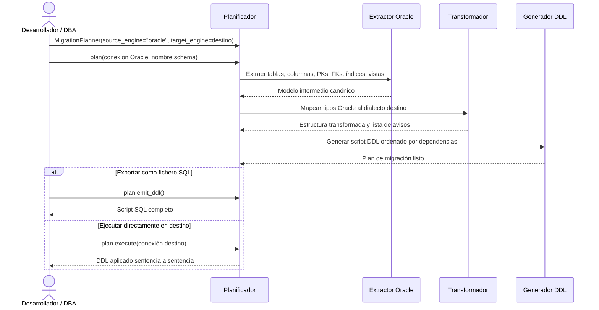

# Migración Oracle como origen

## Objetivo de negocio

Genera automáticamente el script SQL de creación de estructura (DDL) de un schema Oracle completo,
listo para ejecutarse en **MariaDB**, **SQL Server** o **PostgreSQL**. Cubre tablas, columnas,
claves primarias, claves foráneas, índices, vistas y tipos de datos, adaptando cada elemento a
las reglas del motor destino sin modificar la base de datos origen ni la de destino hasta que el
usuario lo autorice.

Responde a la pregunta "¿cómo paso mi estructura Oracle a otro motor sin reescribir el DDL a mano?"
de forma reproducible y auditada: cada decisión de conversión queda registrada como aviso con
nivel de severidad.

## Precondiciones

- Conexión activa al servidor Oracle con permisos de lectura sobre `ALL_TABLES`, `ALL_TAB_COLUMNS`,
  `ALL_CONSTRAINTS`, `ALL_INDEXES` y `ALL_VIEWS` del schema a migrar
- Identificar el nombre del schema/owner Oracle que se va a migrar
- Decidir el motor destino y sus parámetros específicos:

| Motor destino | Parámetro adicional | Valor por defecto |
|---|---|---|
| MariaDB | `charset` / `collation` | `utf8mb4` / `utf8mb4_unicode_ci` |
| SQL Server | `sql_server_collation` | Sin cláusula COLLATE explícita |
| PostgreSQL | `pg_schema` | Sin `SET search_path` |

- Opcional: conexión activa al servidor destino si se desea ejecución directa en lugar de exportar el script

## Flujo principal del usuario



## Reglas de negocio críticas

| Regla | Descripción | Impacto si se viola |
|---|---|---|
| Nombres preservados por defecto | Tablas, columnas, índices y FKs conservan el nombre original Oracle | Solo se truncan si superan el límite del motor destino; no se normalizan a minúsculas |
| Truncado determinista de identificadores | Nombres demasiado largos se recortan + sufijo hash de 4 chars; límites: MariaDB 64, SQL Server 128, PostgreSQL 63 | El sufijo garantiza unicidad; cada truncado queda en el plan como aviso |
| `NUMBER` sin precisión → tipo configurable | `NUMBER` Oracle sin precisión explícita se mapea por defecto: `DOUBLE` (MariaDB), `FLOAT` (SQL Server), `DOUBLE PRECISION` (PostgreSQL) | Posible pérdida de exactitud numérica; configurable mediante `number_fallback` |
| `NUMBER(p, 0)` → entero según rango | `NUMBER` con escala 0 se mapea a `TINYINT/SMALLINT/INT/BIGINT` o equivalente según la precisión y el motor destino | Uso óptimo de espacio; sin pérdida de rango para precisiones hasta 18 |
| Secuencias Oracle → autoincremento | Columnas con DEFAULT `SECUENCIA.NEXTVAL` pasan a `AUTO_INCREMENT` (MariaDB), `IDENTITY(1,1)` (SQL Server) o `SERIAL/BIGSERIAL` (PostgreSQL) | La secuencia no se migra como objeto independiente |
| `ROWID` y `UROWID` omitidos | Estas columnas no tienen equivalente en los motores destino y se excluyen del DDL | El DDL incluye un comentario SQL explicativo en su lugar |
| FKs que referencian tablas externas omitidas | Claves foráneas fuera del schema migrado se excluyen del script generado | Aviso registrado; el desarrollador debe gestionar esas referencias manualmente post-migración |
| FKs circulares al final del script | Las dependencias circulares entre tablas se emiten como `ALTER TABLE ADD CONSTRAINT` al final | El script completo es ejecutable en orden sin necesidad de desactivar comprobaciones de FK |

## Ejemplos de funcionamiento

=== "Oracle → MariaDB"

    ```python
    from util_bbdd import MigrationPlanner
    from util_bbdd.migrate import format_plan_text

    planner = MigrationPlanner(
        source_engine="oracle",
        target_engine="mariadb",
        charset="utf8mb4",
        collation="utf8mb4_spanish2_ci",
        number_fallback="DOUBLE",
    )

    plan = planner.plan(connection=oracle_manager, schema="HR")
    print(format_plan_text(plan))

    with open("hr_schema_mariadb.sql", "w", encoding="utf-8") as f:
        f.write(plan.emit_ddl())
    ```

=== "Oracle → SQL Server"

    ```python
    from util_bbdd import MigrationPlanner

    planner = MigrationPlanner(
        source_engine="oracle",
        target_engine="sqlserver",
        sql_server_collation="SQL_Latin1_General_CP1_CI_AS",  # opcional
    )

    plan = planner.plan(connection=oracle_manager, schema="HR")

    with open("hr_schema_sqlserver.sql", "w", encoding="utf-8") as f:
        f.write(plan.emit_ddl())
    ```

=== "Oracle → PostgreSQL"

    ```python
    from util_bbdd import MigrationPlanner

    planner = MigrationPlanner(
        source_engine="oracle",
        target_engine="postgresql",
        pg_schema="hr",  # opcional; emite SET search_path = hr;
    )

    plan = planner.plan(connection=oracle_manager, schema="HR")

    with open("hr_schema_postgresql.sql", "w", encoding="utf-8") as f:
        f.write(plan.emit_ddl())
    ```

## Stored procedures y funciones

El módulo migra stored procedures, funciones y paquetes PL/SQL con una estrategia **pass-through v1**:
el cuerpo DDL se extrae verbatim desde `ALL_SOURCE` y se emite en el script destino
acompañado de un comentario de identificación y un aviso de revisión manual.

```sql
-- PROCEDURE: "GET_CLIENTES"
-- NOTE: requires manual review (see migration warnings)
PROCEDURE GET_CLIENTES(p_id IN NUMBER) AS
BEGIN
  SELECT * FROM CLIENTES WHERE ID = p_id;
END;
```

Las rutinas se incluyen al final del script DDL, después de tablas y vistas.
El aviso de revisión manual indica que la sintaxis PL/SQL puede requerir adaptación
al dialecto del motor destino.

Los miembros de un **PACKAGE** Oracle se marcan con el comentario
`-- PACKAGE MEMBER: PKG_NAME.ROUTINE_NAME (PROCEDURE|FUNCTION)` y no generan DDL ejecutable
(los paquetes no tienen equivalente directo en MariaDB, SQL Server ni PostgreSQL).

## Límites y exclusiones

- Solo soporta Oracle como motor origen (destinos: MariaDB, SQL Server, PostgreSQL)
- No migra filas de datos, solo la estructura (DDL)
- No migra secuencias Oracle como objetos independientes (se incorporan como autoincremento)
- Las rutinas se emiten verbatim (pass-through v1): la sintaxis PL/SQL no se traduce automáticamente
- No modifica ni consulta la base de datos Oracle de forma destructiva en ningún caso
