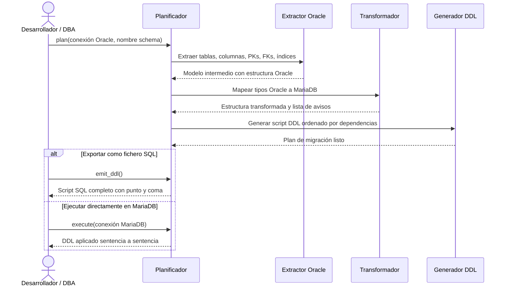

## Objetivo de negocio

Genera automáticamente el script SQL de creación de estructura (DDL) de un schema Oracle completo, listo para ejecutarse en MariaDB. Cubre tablas, columnas, claves primarias, claves foráneas, índices y tipos de datos, adaptando cada elemento a las reglas del motor destino sin modificar la base de datos origen ni la de destino hasta que el usuario lo autorice.

Responde a la pregunta "¿cómo paso mi estructura Oracle a MariaDB sin reescribir el DDL a mano?" de forma reproducible y auditada: cada decisión de conversión queda registrada como aviso con nivel de severidad.

## Precondiciones

- Conexión activa al servidor Oracle con permisos de lectura sobre `ALL_TABLES`, `ALL_TAB_COLUMNS`, `ALL_CONSTRAINTS` y `ALL_INDEXES` del schema a migrar
- Identificar el nombre del schema/owner Oracle que se va a migrar
- Decidir el charset y collation de destino (por defecto `utf8mb4` / `utf8mb4_unicode_ci`; se incluyen variantes en español como `utf8mb4_spanish2_ci`)
- Opcional: conexión activa al servidor MariaDB destino si se desea ejecución directa en lugar de exportar el script

## Flujo principal del usuario



## Reglas de negocio críticas

| Regla | Descripción | Impacto si se viola |
|---|---|---|
| Nombres preservados por defecto | Tablas, columnas, índices y FKs conservan el nombre original de Oracle | Solo se truncan si superan 64 caracteres; no se normalizan a minúsculas |
| Truncado determinista de identificadores | Nombres > 64 chars se recortan a 59 + sufijo hash de 4 chars basado en el nombre completo | El sufijo garantiza unicidad; el aviso queda en el plan de migración |
| `NUMBER` sin precisión → tipo configurable | `NUMBER` Oracle sin precisión explícita se mapea por defecto a `DOUBLE` | Posible pérdida de exactitud numérica; configurable a `DECIMAL(38,10)` o `DECIMAL(18,4)` |
| `NUMBER(p, 0)` → entero según rango | `NUMBER` con escala 0 se mapea a `TINYINT`, `SMALLINT`, `INT` o `BIGINT` según la precisión | Uso óptimo de espacio; sin pérdida de rango para precisiones hasta 18 |
| Secuencias Oracle → `AUTO_INCREMENT` | Columnas con DEFAULT `SECUENCIA.NEXTVAL` pasan a `AUTO_INCREMENT` y la secuencia no se migra | El campo debe ser clave primaria en MariaDB; se añade como PK automáticamente si no lo era |
| `ROWID` y `UROWID` omitidos | Estas columnas no tienen equivalente en MariaDB y se excluyen del DDL | El DDL incluye un comentario SQL explicativo en su lugar |
| FKs que referencian tablas externas omitidas | Claves foráneas fuera del schema migrado se excluyen del script generado | Aviso registrado; el desarrollador debe gestionar esas referencias manualmente post-migración |
| FKs circulares al final del script | Las dependencias circulares entre tablas se emiten como `ALTER TABLE ADD CONSTRAINT` al final | El script completo es ejecutable en orden sin necesidad de desactivar comprobaciones de FK |
| Charset siempre explícito | Todas las tablas y columnas de texto incluyen `CHARACTER SET utf8mb4` | Sin charset explícito MariaDB aplica el charset del servidor, que puede diferir |

## Ejemplo de funcionamiento

```python
from util_bbdd import MigrationPlanner
from util_bbdd.migrate import format_plan_text

planner = MigrationPlanner(
    charset="utf8mb4",
    collation="utf8mb4_spanish2_ci",   # español moderno
    number_fallback="DOUBLE",
)

plan = planner.plan(connection=oracle_manager, schema="HR")

# Revisar avisos antes de aplicar
print(format_plan_text(plan))

# Exportar el script SQL a disco
with open("hr_schema_mariadb.sql", "w", encoding="utf-8") as f:
    f.write(plan.emit_ddl())

# Aplicar directamente en MariaDB (opcional)
plan.execute(target_connection=mariadb_manager)
```

El fichero `hr_schema_mariadb.sql` contiene sentencias `CREATE TABLE`, `CREATE INDEX` y, si hay dependencias circulares, `ALTER TABLE ADD CONSTRAINT`, todas terminadas en `;` y separadas por líneas en blanco.

## Límites y exclusiones

- Solo soporta Oracle como origen y MariaDB como destino en la versión actual
- No migra filas de datos, solo la estructura (DDL)
- No migra triggers, stored procedures, funciones ni paquetes PL/SQL
- No migra secuencias Oracle como objetos independientes (se incorporan como `AUTO_INCREMENT`)
- No modifica ni consulta la base de datos Oracle de forma destructiva en ningún caso
