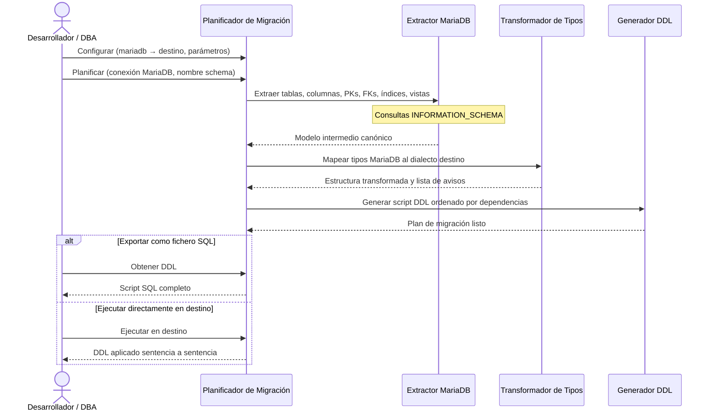

# Migración MariaDB como Origen

## 1. Descripción General

Genera automáticamente el script SQL de creación de estructura (DDL) de un schema MariaDB completo, listo para ejecutarse en Oracle, MySQL, SQL Server o PostgreSQL. Cubre tablas, columnas, claves primarias, claves foráneas, índices, vistas y tipos de datos, adaptando cada elemento a las reglas del motor destino sin modificar la base de datos origen ni la de destino hasta que el usuario lo autorice.

Responde a la pregunta "¿cómo paso mi estructura MariaDB a otro motor sin reescribir el DDL a mano?" de forma reproducible y auditada: cada decisión de conversión queda registrada como aviso con nivel de severidad.

**Precondiciones:**

- Un `SyncDatabaseManager` del MariaDB origen (o una `MetadataSource`), con permisos de lectura sobre
  `INFORMATION_SCHEMA` del schema a migrar: `MigrationPlanner(...).plan(manager, schema)`
- Nombre del schema MariaDB a migrar identificado (equivale a `TABLE_SCHEMA`)
- Motor destino decidido: Oracle, MySQL, SQL Server o PostgreSQL
- Opcional: conexión activa al servidor destino si se desea ejecución directa

## 2. Reglas de Negocio

| Regla | Descripción | Impacto si se viola |
|---|---|---|
| Nombres preservados por defecto | Tablas, columnas, índices y FKs conservan el nombre original MariaDB | Solo se truncan si superan el límite del motor destino |
| Truncado determinista de identificadores | Nombres demasiado largos se recortan con sufijo hash de 4 chars; límites: Oracle 30 bytes, SQL Server 128 caracteres, PostgreSQL 63 bytes, MySQL 64 caracteres | El sufijo garantiza unicidad; cada truncado queda en el plan como aviso |
| `AUTO_INCREMENT` → equivalente destino | Columnas `AUTO_INCREMENT` se convierten al mecanismo equivalente del motor destino | El mecanismo de autoincremento queda funcional en el motor destino |
| `TEXT`/`LONGTEXT` → tipos equivalentes | Tipos de texto largo se mapean al tipo más cercano del motor destino | Posible cambio de límite máximo de caracteres; aviso registrado en plan |
| FKs que referencian tablas externas omitidas | Claves foráneas fuera del schema migrado se excluyen del script | Aviso registrado; el desarrollador gestiona esas referencias manualmente |
| FKs circulares al final del script | Las dependencias circulares se emiten como `ALTER TABLE ADD CONSTRAINT` al final | El script completo es ejecutable en orden sin desactivar comprobaciones de FK |
| Vistas reescritas al destino | El SQL de las vistas se reescribe al dialecto destino con sqlglot (ver [reescritura de vistas](migrate_views.md)); sin sqlglot se copia sin reescribir | Aviso de revisión por cada vista |

## 3. Casos de Uso

### Flujo principal

### Flujos alternativos

**Vistas con SQL MariaDB-específico:** el SQL de las vistas se reescribe al dialecto destino (ver [reescritura de vistas](migrate_views.md)); las construcciones sin traducción fiable se copian sin reescribir con aviso de revisión manual.

**Límites y exclusiones:**

- Destinos: Oracle, MySQL, SQL Server y PostgreSQL (origen y destino no pueden ser el mismo motor)
- No migra filas de datos, solo la estructura (DDL)
- Los procedimientos y funciones se emiten verbatim (pass-through, aviso `ROUTINE_PASSTHROUGH`): la sintaxis no se
  traduce. No migra triggers
- Las vistas se reescriben con sqlglot (extra `util_bbdd[migrate]`); sin él, se copian sin reescribir ([reescritura de vistas](migrate_views.md))
- No modifica ni consulta la base de datos MariaDB de forma destructiva

## 4. Glosario y Términos

| Término | Definición |
|---|---|
| DDL | Data Definition Language: sentencias SQL que definen la estructura de la base de datos |
| Pass-through | Estrategia que emite el código fuente (rutinas; vistas sin sqlglot o con `view_strategy="passthrough"`) sin modificarlo, con un aviso de revisión manual |
| Plan de migración | Objeto que contiene el DDL generado, los avisos y métodos para exportar o ejecutar el script |
| `TABLE_SCHEMA` | Nombre del schema en MariaDB tal como aparece en `INFORMATION_SCHEMA.TABLES` |
