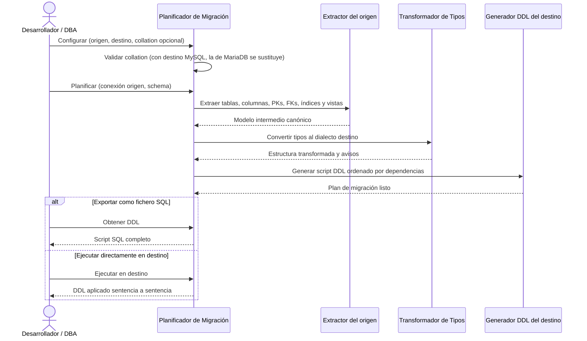

# Migración con MySQL (origen y destino)

## 1. Descripción General

Genera el script de estructura (DDL) de un schema MySQL para crearlo en Oracle, SQL Server, PostgreSQL o MariaDB, y
el script para crear en MySQL un schema que viene de cualquiera de esos motores. Cubre tablas, columnas, claves
primarias, claves foráneas, índices y vistas, y deja cada decisión de conversión registrada como aviso en el plan.

MySQL y MariaDB comparten casi toda la sintaxis de tipos y el mismo `INFORMATION_SCHEMA`, así que MySQL reutiliza
las reglas de conversión de MariaDB y solo añade lo que los diferencia: la collation por defecto, los tipos que solo
existen en MariaDB y el ancho de visualización de los enteros.

**Precondiciones:**

- Un `SyncDatabaseManager` del motor origen (o una `MetadataSource`) con permisos de lectura sobre su catálogo
  (`INFORMATION_SCHEMA` en MySQL)
- Nombre del schema a migrar (en MySQL, la base de datos: `TABLE_SCHEMA`)
- Motor destino decidido: Oracle, SQL Server, PostgreSQL, MariaDB o MySQL (MySQL 8.0 o superior)
- Opcional: conexión activa al servidor destino si se desea ejecución directa

## 2. Reglas de Negocio

| Regla | Descripción | Impacto si se viola |
|---|---|---|
| Collation por defecto en MySQL | Con destino MySQL, las tablas se crean con `utf8mb4_0900_ai_ci` | La collation por defecto de MariaDB (`utf8mb4_uca1400_ai_ci`) no existe en MySQL y el `CREATE TABLE` fallaría |
| Collations exclusivas de MariaDB rechazadas | Pedir `utf8mb4_uca1400_ai_ci` con destino MySQL es un error de configuración | El planificador lo rechaza antes de extraer nada |
| Enteros sin ancho de visualización | En MySQL se emite `INT` en lugar de `INT(11)`; `TINYINT(1)` se conserva | MySQL 8 declara obsoleto el ancho y avisa en cada columna |
| Tipo completo entre MySQL y MariaDB | En ambos sentidos se conserva el tipo tal cual (`enum('a','b')`, `int unsigned`) | Sin él se perderían los valores de `ENUM` y el `UNSIGNED` |
| Tipos exclusivos de MariaDB | De MariaDB a MySQL: `UUID` → `CHAR(36)`, `INET4` → `VARCHAR(15)`, `INET6` → `VARCHAR(39)` | Cada sustitución queda como aviso en el plan |
| Defaults literales | Los valores por defecto de texto y fecha se tratan como literales entrecomillados; las expresiones (`CURRENT_TIMESTAMP`) no | Un `VARCHAR` con default `'5'` no se convierte en el número `5` |
| Nombres preservados | Tablas, columnas, índices y FKs conservan su nombre; MySQL y MariaDB admiten 64 caracteres | Solo se truncan al pasar a un motor con un límite menor, con aviso |
| Vistas reescritas al destino | El SQL de la vista se reescribe al dialecto destino con sqlglot (ver [reescritura de vistas](migrate_views.md)) | Aviso de revisión por cada vista; sin sqlglot se copia sin reescribir |

## 3. Casos de Uso

### Flujo principal

### Flujos alternativos

**Migración entre MySQL y MariaDB:** el tipo de cada columna pasa sin conversión. Solo cambian la collation de la
tabla y, de MariaDB a MySQL, los tipos que MySQL no tiene.

**Collation explícita:** si se indica una collation válida en MySQL (p. ej. `utf8mb4_bin`), se usa tal cual.

**Límites y exclusiones:**

- No migra filas de datos, solo la estructura (DDL); para los datos, ver el volcado entre motores (`dump`)
- Las rutinas se copian sin reescribir su SQL; las vistas se reescriben al destino ([reescritura de vistas](migrate_views.md)); revisar los avisos del plan antes de ejecutar
- Los valores por defecto se traducen al destino (literales, números, `NULL`, `CURRENT_TIMESTAMP`, `CURRENT_DATE` y
  booleanos); una función propia del motor origen sin equivalente (p. ej. `newid()`) se emite como literal con un
  aviso en el plan para revisarla

## 4. Glosario y Términos

| Término | Definición |
|---|---|
| Collation | Regla de ordenación y comparación de texto de una tabla o columna |
| Ancho de visualización | Número entre paréntesis de los enteros (`INT(11)`); no limita el rango y MySQL 8 lo declara obsoleto |
| Pass-through | Estrategia que copia el SQL original (rutinas; vistas sin sqlglot o con `view_strategy="passthrough"`) sin modificarlo, con aviso de revisión manual |
| Plan de migración | Objeto con el DDL generado, los avisos y métodos para exportar o ejecutar el script |
| `TABLE_SCHEMA` | Nombre del schema en MySQL/MariaDB tal como aparece en `INFORMATION_SCHEMA.TABLES` |
