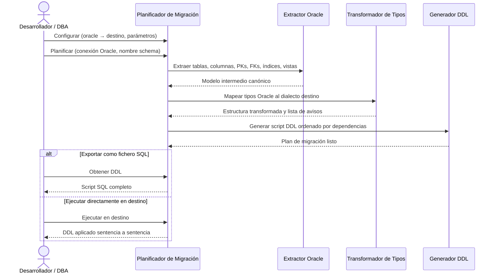

# Migración Oracle como Origen

## 1. Descripción General

Genera automáticamente el script SQL de creación de estructura (DDL) de un schema Oracle completo, listo para ejecutarse en MariaDB, MySQL, SQL Server o PostgreSQL. Cubre tablas, columnas, claves primarias, claves foráneas, índices, vistas y tipos de datos, adaptando cada elemento a las reglas del motor destino sin modificar la base de datos origen ni la de destino hasta que el usuario lo autorice.

Responde a la pregunta "¿cómo paso mi estructura Oracle a otro motor sin reescribir el DDL a mano?" de forma reproducible y auditada: cada decisión de conversión queda registrada como aviso con nivel de severidad.

**Precondiciones:**

- Un `SyncDatabaseManager` del Oracle origen (o una `MetadataSource`) con permisos de lectura sobre `ALL_TABLES`, `ALL_TAB_COLUMNS`, `ALL_CONSTRAINTS`, `ALL_INDEXES` y `ALL_VIEWS` del schema a migrar
- Nombre del schema/owner Oracle a migrar identificado
- Motor destino decidido: MariaDB, MySQL, SQL Server o PostgreSQL
- Opcional: conexión activa al servidor destino si se desea ejecución directa

## 2. Reglas de Negocio

| Regla | Descripción | Impacto si se viola |
|---|---|---|
| Nombres preservados por defecto | Tablas, columnas, índices y FKs conservan el nombre original Oracle | Solo se truncan si superan el límite del motor destino; no se normalizan a minúsculas |
| Truncado determinista de identificadores | Nombres demasiado largos se recortan con sufijo hash de 4 chars | El sufijo garantiza unicidad; cada truncado queda en el plan como aviso |
| `NUMBER` sin precisión → tipo configurable | `NUMBER` Oracle sin precisión explícita se mapea según configuración de `number_fallback` | Posible pérdida de exactitud numérica; configurable por el usuario |
| Secuencias Oracle → autoincremento | Columnas con DEFAULT de secuencia pasan a AUTO_INCREMENT, IDENTITY o SERIAL según motor destino | La secuencia no se migra como objeto independiente |
| `ROWID` y `UROWID` omitidos | Estas columnas no tienen equivalente en los motores destino y se excluyen del DDL | El DDL incluye un comentario SQL explicativo en su lugar |
| FKs circulares al final del script | Las dependencias circulares se emiten como `ALTER TABLE ADD CONSTRAINT` al final | El script completo es ejecutable en orden sin desactivar comprobaciones de FK |

## 3. Casos de Uso

### Flujo principal

### Flujos alternativos

**Stored procedures y funciones:** El módulo extrae el cuerpo PL/SQL verbatim desde el catálogo Oracle y lo emite con un aviso de revisión manual. La sintaxis PL/SQL no se traduce automáticamente al dialecto destino.

**FKs que referencian tablas externas:** Las claves foráneas fuera del schema migrado se excluyen del script y se registran como aviso; el desarrollador debe gestionar esas referencias manualmente.

**Límites y exclusiones:**

- Destinos: MariaDB, MySQL, SQL Server y PostgreSQL (origen y destino no pueden ser el mismo motor)
- No migra filas de datos, solo la estructura (DDL)
- No migra secuencias Oracle como objetos independientes (se incorporan como autoincremento)
- Las rutinas se emiten verbatim (pass-through): la sintaxis PL/SQL no se traduce automáticamente
- No modifica ni consulta la base de datos Oracle de forma destructiva

## 4. Criterios de Aceptación

Derivados de los tests de la migración con Oracle como origen (destino MariaDB salvo que se indique).

| ID | Dado | Cuando | Entonces |
|---|---|---|---|
| AC-01 | Columnas `NUMBER(10,2)`, `NUMBER(15,0)` y `NUMBER` sin precisión | Se transforma la tabla | Se obtiene `DECIMAL(10,2)`, `BIGINT` y `DOUBLE`; el último con aviso |
| AC-02 | Una columna `ROWID` | Se transforma la tabla | La columna se omite del DDL |
| AC-03 | Una columna de PK con default `MI_SECUENCIA.NEXTVAL` | Se transforma la tabla | Pasa a autoincremento y pierde el default de la secuencia |
| AC-04 | Un nombre de tabla de más de 64 caracteres | Se transforma | Se recorta a 64 con sufijo hash y queda un aviso de categoría `IDENTIFIER` |
| AC-05 | Dos nombres largos distintos, o el mismo nombre dos veces | Se recortan | El mismo nombre da siempre el mismo resultado y nombres distintos dan resultados distintos |
| AC-06 | Una clave foránea a una tabla fuera del schema migrado | Se transforma | Queda un aviso para gestionarla a mano |
| AC-07 | Dos tablas con claves foráneas entre sí | Se genera el DDL | Se detecta el ciclo y esas claves se emiten como `ALTER TABLE` al final del script |

## 5. Glosario y Términos

| Término | Definición |
|---|---|
| DDL | Data Definition Language: sentencias SQL que definen la estructura de la base de datos (CREATE TABLE, ALTER TABLE, etc.) |
| Pass-through | Estrategia de migración que emite el código fuente (PL/SQL; vistas sin sqlglot o con `view_strategy="passthrough"`) sin modificarlo, con un aviso de revisión manual |
| Plan de migración | Objeto inmutable que contiene el DDL generado, la lista de avisos por severidad y métodos para exportar o ejecutar el script |
| `number_fallback` | Parámetro que controla el tipo destino para columnas `NUMBER` Oracle sin precisión explícita |
