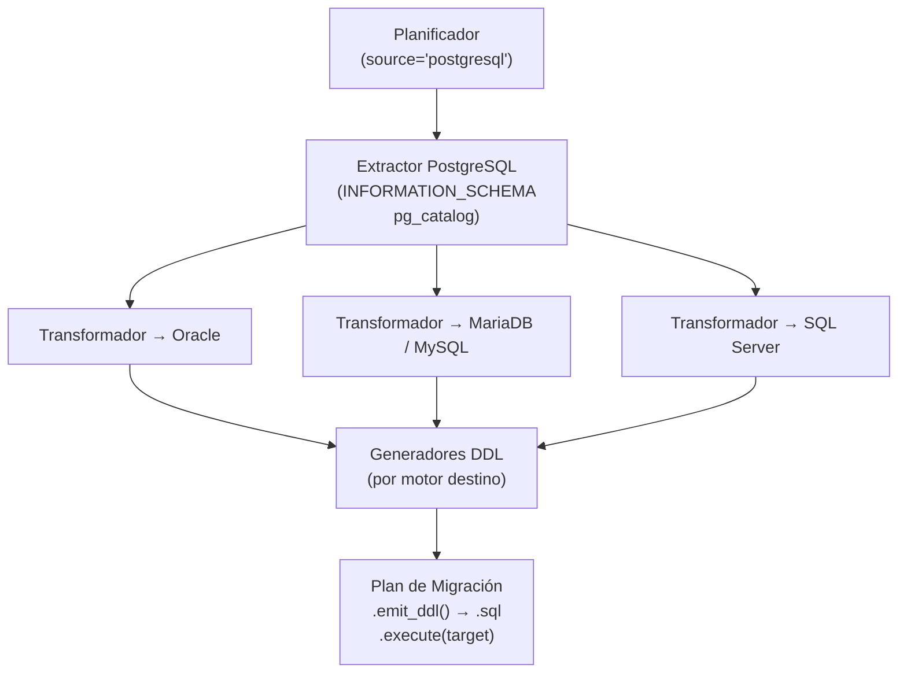

# Migración PostgreSQL como Origen

## 1. Descripción General

Genera automáticamente el script SQL de creación de estructura (DDL) de un schema PostgreSQL completo, listo para ejecutarse en Oracle, MariaDB, MySQL o SQL Server. Cubre tablas, columnas, claves primarias, claves foráneas, índices, vistas y tipos de datos, adaptando cada elemento a las reglas del motor destino.

El flujo de trabajo es idéntico al de otros motores origen: leer los metadatos del schema → transformar tipos → emitir DDL ordenado por dependencias.

**Precondiciones:**

- Un `SyncDatabaseManager` del PostgreSQL origen (o una `MetadataSource`): `MigrationPlanner(...).plan(manager, schema)`
  lee el schema con una consulta por tipo de objeto (`metadata/`, ADR-003), con el driver que use el manager
- El parámetro `schema` corresponde a `TABLE_SCHEMA` en PostgreSQL (habitualmente `'public'`)
- La conexión debe apuntar a la base de datos correcta

## 2. Reglas de Negocio

| Regla | Descripción | Impacto si se viola |
|---|---|---|
| Detección de SERIAL como autoincremento | Columnas SERIAL/BIGSERIAL/SMALLSERIAL se detectan por su `COLUMN_DEFAULT` de tipo `nextval(...)` | Sin detección, la columna se genera sin autoincremento en el destino |
| `CHARACTER VARYING` sin límite → LOB | `character varying` sin longitud produce tipo LOB en el destino (CLOB, LONGTEXT o NVARCHAR(MAX)) | Posible cambio de semántica de almacenamiento; aviso incluido en el plan |
| Índices no-PK via pg_catalog | Los índices secundarios se obtienen de `pg_catalog.pg_index`, no de `INFORMATION_SCHEMA` | Sin este paso, los índices secundarios no se incluyen en el DDL generado |
| Vistas reescritas al destino | El SQL de las vistas se reescribe al dialecto destino con sqlglot (ver [reescritura de vistas](migrate_views.md)); sin sqlglot se emite sin traducir | Aviso de revisión por cada vista |
| FKs circulares al final del script | Las dependencias circulares se emiten como `ALTER TABLE ADD CONSTRAINT` al final | El script completo es ejecutable en orden sin desactivar comprobaciones de FK |

## 3. Casos de Uso

### Flujo principal

### Flujos alternativos

**Stored procedures y funciones:** El módulo extrae el cuerpo de cada rutina verbatim con un aviso de revisión manual. La sintaxis PL/pgSQL no se traduce automáticamente.

**Tipos sin equivalente directo:** Tipos PostgreSQL-específicos (`ARRAY`, `TSVECTOR`, `USER-DEFINED`) se mapean al tipo LOB más cercano del motor destino con severidad ERROR en el plan de avisos.

**Límites y exclusiones:**

- Destinos: Oracle, MariaDB, MySQL y SQL Server (origen y destino no pueden ser el mismo motor)
- No migra filas de datos, solo la estructura (DDL)
- Se migran los comentarios de tablas y columnas (desde 0.21.0) y de vistas hacia PostgreSQL, SQL Server y Oracle
  (desde 0.22.0; MariaDB/MySQL no tienen comentarios de vista: aviso `VIEW_COMMENT_UNSUPPORTED`). Los de rutinas
  se escriben en el script (desde 0.23.0)
- Los tipos espaciales, arrays y enums se mapean a tipos de texto con aviso de severidad ERROR

## 4. Criterios de Aceptación

Derivados de los tests de la migración con PostgreSQL como origen.

| ID | Dado | Cuando | Entonces |
|---|---|---|---|
| AC-01 | Una columna con default `nextval(...)` (en cualquier capitalización) o declarada `IDENTITY` | Se extrae | Se marca como autoincremento; con default `42` o sin default, no |
| AC-02 | Una tabla `users` con `id integer` y default `nextval('users_id_seq'::regclass)` | Se planifica la migración a MariaDB | La columna queda como `INT` con autoincremento |
| AC-03 | Una columna `character varying` sin longitud | Se transforma a MariaDB, Oracle o SQL Server | Se obtiene `LONGTEXT`, `CLOB` o `NVARCHAR(MAX)` |
| AC-04 | Una columna `character varying(255)` | Se transforma a MariaDB | Se obtiene `VARCHAR(255)` |
| AC-05 | Una vista | Se transforma a MariaDB | Lleva un aviso de revisión que menciona PostgreSQL |

## 5. Glosario y Términos

| Término | Definición |
|---|---|
| SERIAL / BIGSERIAL | Tipos PostgreSQL que definen columnas con autoincremento mediante una secuencia interna |
| `TABLE_SCHEMA` | Nombre del schema en PostgreSQL tal como aparece en `INFORMATION_SCHEMA.TABLES` (habitualmente `'public'`) |
| Pass-through | Estrategia que emite el código fuente de rutinas (y de vistas sin sqlglot o con `view_strategy="passthrough"`) sin modificarlo, con aviso de revisión manual |
| `pg_catalog` | Catálogo interno de PostgreSQL que expone metadatos avanzados no disponibles en `INFORMATION_SCHEMA` estándar |
