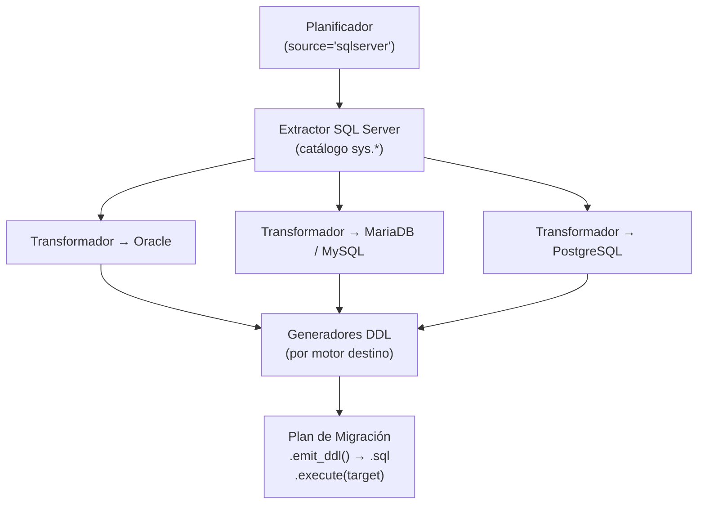

# Migración SQL Server como Origen

## 1. Descripción General

Genera automáticamente el script SQL de creación de estructura (DDL) de un schema SQL Server completo, listo para ejecutarse en Oracle, MariaDB, MySQL o PostgreSQL. Cubre tablas, columnas, claves primarias, claves foráneas, índices, vistas y tipos de datos, adaptando cada elemento a las reglas del motor destino.

El flujo de trabajo es idéntico al de otros motores origen: leer los metadatos del schema de las vistas de catálogo `sys.*` → transformar tipos → emitir DDL ordenado por dependencias.

**Precondiciones:**

- Un `SyncDatabaseManager` del SQL Server origen (o una `MetadataSource`): `MigrationPlanner(...).plan(manager, schema)`
  lee el schema con una consulta por tipo de objeto (`metadata/`, ADR-003), con el driver que use el manager
- El parámetro `schema` corresponde a `TABLE_SCHEMA` en SQL Server (habitualmente `'dbo'`)
- La conexión debe apuntar a la base de datos correcta

## 2. Reglas de Negocio

| Regla | Descripción | Impacto si se viola |
|---|---|---|
| Tipos MAX (char_length = -1) | SQL Server usa `-1` como sentinel para `VARCHAR(MAX)`, `NVARCHAR(MAX)` y `VARBINARY(MAX)` | Sin detección, el tipo LOB no se genera correctamente en el destino |
| Columnas IDENTITY detectadas en el catálogo | La detección de columnas IDENTITY usa el catálogo del sistema (`sys.*`) | Sin detección, la columna se genera sin autoincremento en el destino |
| Vistas reescritas al destino | El SQL de las vistas se reescribe al dialecto destino con sqlglot (ver [reescritura de vistas](migrate_views.md)); sin sqlglot se emite sin traducir | Aviso de revisión por cada vista |
| Definiciones completas | Vistas y rutinas se leen con `OBJECT_DEFINITION` (sin el límite de 4000 caracteres de `INFORMATION_SCHEMA.VIEW_DEFINITION`); una vista cifrada (`WITH ENCRYPTION`) o sin permiso `VIEW DEFINITION` no tiene definición | Aviso `VIEW_DEFINITION_UNAVAILABLE` y la vista no se emite |
| FKs circulares al final del script | Las dependencias circulares se emiten como `ALTER TABLE ADD CONSTRAINT` al final | El script completo es ejecutable en orden sin desactivar comprobaciones de FK |

## 3. Casos de Uso

### Flujo principal

### Flujos alternativos

**Stored procedures y funciones:** El módulo extrae el cuerpo T-SQL (`OBJECT_DEFINITION`) verbatim con un aviso de revisión manual. La sintaxis T-SQL (variables `@`, `TOP`, `NOLOCK`, `GETDATE()`) no se traduce automáticamente.

**Tipos geoespaciales:** `GEOGRAPHY` y `GEOMETRY` se mapean a tipos de texto con severidad ERROR en el plan de avisos, indicando que requieren revisión manual para conversión espacial.

**Límites y exclusiones:**

- Destinos: Oracle, MariaDB, MySQL y PostgreSQL (origen y destino no pueden ser el mismo motor)
- No migra filas de datos, solo la estructura (DDL)
- No soporta columnas computadas, UDTs, tipos alias ni tablas temporales
- Las vistas se reescriben con sqlglot (extra `util_bbdd[migrate]`); sin él, se copian sin reescribir ([reescritura de vistas](migrate_views.md))
- Se migran los comentarios de tablas y columnas (desde 0.21.0) y de vistas hacia PostgreSQL, SQL Server y Oracle
  (desde 0.22.0; MariaDB/MySQL no tienen comentarios de vista: aviso `VIEW_COMMENT_UNSUPPORTED`). Los de rutinas
  se escriben en el script (desde 0.23.0)

## 4. Glosario y Términos

| Término | Definición |
|---|---|
| IDENTITY | Mecanismo de autoincremento en SQL Server; equivale a `AUTO_INCREMENT` (MariaDB), `SERIAL` (PostgreSQL) o `SEQUENCE+TRIGGER` (Oracle) |
| T-SQL | Dialecto SQL propietario de SQL Server con extensiones propias (`@variables`, `TOP`, `NOLOCK`, `GETDATE()`) |
| Pass-through | Estrategia que emite el código fuente de rutinas (y de vistas sin sqlglot o con `view_strategy="passthrough"`) sin modificarlo, con aviso de revisión manual |
| `sys.sql_modules` | Vista del catálogo interno de SQL Server que expone el código fuente de procedimientos, funciones y vistas |
