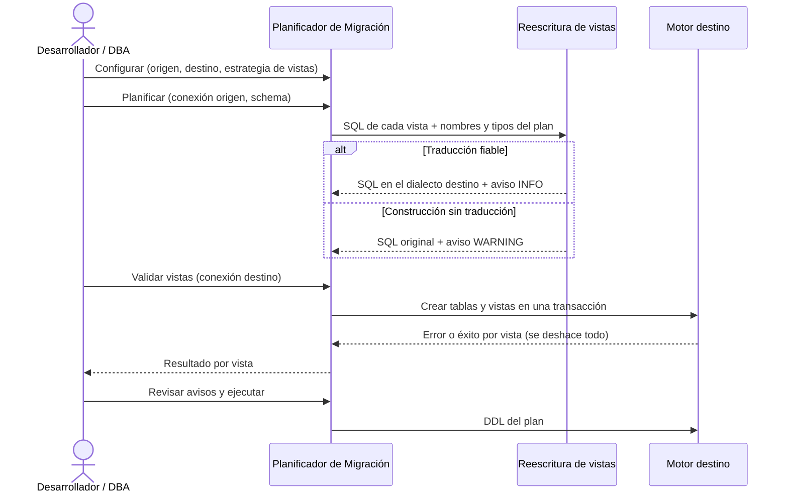

# Migración de vistas entre motores

## 1. Descripción General

Al migrar un schema con `MigrationPlanner`, el SQL de cada vista se reescribe al dialecto del motor destino: nombres
de tablas y columnas del plan, funciones equivalentes, sintaxis de límites de filas, aritmética de fechas y
construcciones propias del origen (outer join `(+)` de Oracle, `ROWNUM`, `ILIKE`, agregados de texto). Antes de
ejecutar el plan, las vistas se pueden validar contra el destino sin dejar cambios.

Cubre los 20 pares entre Oracle, MariaDB, MySQL, SQL Server y PostgreSQL. La reescritura usa
[sqlglot](https://github.com/tobymao/sqlglot), una dependencia opcional (`pip install "util_bbdd[migrate]"`); sin ella,
las vistas se copian sin reescribir, como hasta la versión 0.19.0.

**Precondiciones:**

- Las mismas que la migración DDL del motor origen (ver las páginas de cada origen en «Migración de Esquemas»)
- Para reescribir: sqlglot instalado (extra `util_bbdd[migrate]`)
- Para validar con destino PostgreSQL o SQL Server: conexión al servidor destino con permiso para crear tablas y
  vistas (se deshacen al terminar)

## 2. Reglas de Negocio

| Regla | Descripción | Impacto si se viola |
|---|---|---|
| Estrategia por defecto `"auto"` | Reescribe si sqlglot está instalado; si no, copia el SQL sin reescribir | Sin sqlglot, las vistas suelen fallar al crearse en otro motor |
| Nombres del plan | La vista usa los nombres de tablas, vistas y columnas del destino (mayúsculas en Oracle, truncados si hace falta) y pierde el prefijo del schema origen | Una vista que apunte al schema origen no existe en el destino |
| Aviso por vista reescrita | Cada vista reescrita lleva un aviso `INFO` «VIEW (reescrita)» para revisarla | — |
| Semántica de Oracle | Si el origen o el destino es Oracle, aviso `WARNING`: en Oracle la cadena vacía es `NULL` y `\|\|` ignora los `NULL` | La vista se crea, pero puede devolver otros datos con cadenas vacías o concatenaciones con `NULL` |
| Jerarquías de Oracle | `START WITH` + `CONNECT BY PRIOR a = b` sobre una sola tabla (con `AND LEVEL <= n` opcional en la condición, `LEVEL`, `SYS_CONNECT_BY_PATH` sobre texto variable o enteros, `CONNECT_BY_ROOT` y `CONNECT_BY_ISLEAF`) se convierte en una CTE recursiva; el `WHERE` se aplica **después** de recorrer la jerarquía, como en Oracle, y no convierte en hoja a un nodo cuyos hijos filtra. El generador `FROM dual CONNECT BY LEVEL <= n` también | Un filtro aplicado dentro de la jerarquía podaría las ramas bajo un nodo filtrado |
| `NOCYCLE` | La CTE guarda los valores de la columna de `PRIOR` del camino: en PostgreSQL, un array de texto; en MySQL, MariaDB y SQL Server, un texto separado por `CHAR(31)` que se busca en binario (claves numéricas o de texto; una clave con `CHAR(31)` podría dar un falso ciclo). No baja a una fila que ya está en él y `CONNECT_BY_ISLEAF` no cuenta ese hijo, como Oracle. `CONNECT_BY_ISCYCLE` vale 1 si la fila tiene un hijo que ya está en el camino (ella misma incluida) y que la condición visitaría (con `AND LEVEL <= n`, un hijo más allá del nivel máximo no cuenta). Una fila con `NULL` en esa columna se conserva. Supone que esa columna identifica la fila (una clave). Con claves de texto que solo difieren en mayúsculas o acentos, el destino debe usar una collation binaria o que las distinga (con la de por defecto de MySQL, MariaDB y SQL Server, `'A' = 'a'` también en la condición `CONNECT BY`). El camino de MySQL/MariaDB admite unos 10 000 caracteres (más da error 1406) | Sin `NOCYCLE`, un ciclo en los datos no termina o supera el límite de recursión |
| `ORDER SIBLINGS BY` | Una CTE previa numera los hermanos (`ROW_NUMBER()` por padre) con las mismas claves y el mismo orden de `NULL` que Oracle; la CTE recursiva encadena esos números y la vista ordena por esa ruta: orden en profundidad con los hermanos ordenados. Claves: columnas de la tabla. SQL Server no admite `ORDER BY` en una vista: se convierte sin el orden y el aviso lo dice | Sin él, el orden de las filas de la vista no es el de Oracle |
| `SELECT *` en una jerarquía | Se expande con las columnas de la tabla, en su orden, antes de convertir; en el generador `FROM dual` la vista se copia sin reescribir | La CTE solo lleva las columnas que usa la consulta |
| Límite de recursión y ciclos | Aviso `WARNING` «VIEW (jerarquía)»: SQL Server corta a 100 niveles y MySQL a 1000 (una vista no puede ampliarlo); en PostgreSQL y MariaDB un ciclo en los datos hace que la consulta no termine (salvo con `NOCYCLE`). El generador con más filas que ese límite se copia sin reescribir | Jerarquías profundas o datos con ciclos fallan al consultar la vista |
| Sin traducción fiable → sin reescribir | `CONNECT BY` fuera del subconjunto anterior, `ROWNUM` fuera de un límite de filas o SQL que sqlglot no entiende se copian tal cual con aviso `WARNING` «VIEW (sin reescribir)» | Hay que adaptar esa vista a mano |
| Referencias externas | Una vista que usa objetos fuera del schema migrado se reescribe con aviso `WARNING` «VIEW (referencia externa)» | El objeto referenciado debe existir en el destino |
| Validación sin cambios | En PostgreSQL y SQL Server se crean tablas y vistas en una transacción que se deshace; en MySQL, MariaDB y Oracle (el DDL confirma solo) se comprueba solo la sintaxis | Validar con DDL no transaccional dejaría objetos en el destino |

## 3. Casos de Uso

### Flujo principal

### Flujos alternativos

**Sin sqlglot:** con la estrategia `"auto"` las vistas se copian sin reescribir, con aviso de revisión; con
`"transpile"` el planificador falla al construirse y pide instalar el extra.

**Mantener el SQL original:** la estrategia `"passthrough"` copia siempre el SQL sin reescribir (comportamiento
hasta 0.19.0).

**Vistas de SQL Server con columnas en la cabecera** (`CREATE VIEW v (a, b) AS ...`): los nombres de la cabecera
pasan a ser alias de las columnas del `SELECT`.

**Límites y exclusiones:**

- No reescribe rutinas (procedimientos, funciones, triggers): siguen copiándose sin reescribir
- `CONNECT BY` solo se convierte en el subconjunto simple: `ORDER SIBLINGS BY` por algo que no es una columna de la
  tabla, joins en la consulta jerárquica, condiciones distintas de `PRIOR a = b` con `AND LEVEL <= n`
  (por ejemplo `AND activo = 1`), `ROWNUM` y jerarquías dentro de subconsultas se copian sin
  reescribir, con el motivo en el aviso
- Sin `ORDER BY`, la vista convertida no conserva el orden en profundidad de Oracle (las filas son las mismas)
- La semántica de Oracle con cadenas vacías y `NULL` solo se avisa; no se corrige
- En MySQL, MariaDB y Oracle la validación es solo sintáctica: no detecta funciones o columnas inexistentes

## 4. Criterios de Aceptación

Derivados de los tests de la reescritura y validación de vistas.

| ID | Dado | Cuando | Entonces |
|---|---|---|---|
| AC-01 | Estrategia `"auto"` | Se resuelve con y sin sqlglot instalado | Con sqlglot se reescribe; sin él se copia el SQL sin reescribir |
| AC-02 | Estrategia `"transpile"` sin sqlglot, o una estrategia desconocida | Se resuelve o se crea el planificador | `ImportError` que indica el extra `util_bbdd[migrate]`, o `ValueError` sobre `view_strategy` |
| AC-03 | Una vista de MySQL que referencia `zzv.zzv_clientes` | Se reescribe a PostgreSQL | Pierde el prefijo del schema de origen, usa nombres entrecomillados del destino y lleva el aviso `INFO` «VIEW (reescrita)» |
| AC-04 | Una vista con origen o destino Oracle | Se reescribe | Lleva el aviso «VIEW (semántica Oracle)» |
| AC-05 | `WHERE activo = 1 AND ROWNUM <= 3` en Oracle | Se reescribe a MySQL | Termina en `LIMIT 3`, sin `ROWNUM` y conservando el resto del filtro |
| AC-06 | `ROWNUM` fuera de un límite de filas, `CONNECT BY` sin traducción fiable o SQL que no se puede analizar | Se reescribe | Se copia sin cambios con el aviso «VIEW (sin reescribir)» |
| AC-07 | Una vista válida y otra con error de sintaxis | Se validan en una transacción | Se informa cuál es válida y el error de la otra, y la base de datos queda sin tablas ni vistas nuevas |

## 5. Glosario y Términos

| Término | Definición |
|---|---|
| Reescritura (transpilado) | Traducción del SQL de una vista del dialecto del motor origen al del destino |
| Estrategia de vistas | Opción `view_strategy` del planificador: `"auto"`, `"transpile"` o `"passthrough"` |
| Pass-through | Copia del SQL original sin modificarlo, con aviso de revisión manual |
| DDL transaccional | Motores (PostgreSQL, SQL Server) en los que `CREATE TABLE`/`CREATE VIEW` se pueden deshacer con `ROLLBACK` |
| CTE recursiva | `WITH RECURSIVE` (`WITH` en SQL Server): una consulta ancla más otra que se une a la propia CTE, equivalente estándar de `CONNECT BY` |
| Top-N | Consulta que devuelve las N primeras filas según un orden (`LIMIT`, `TOP`, `FETCH FIRST`, `ROWNUM`) |
