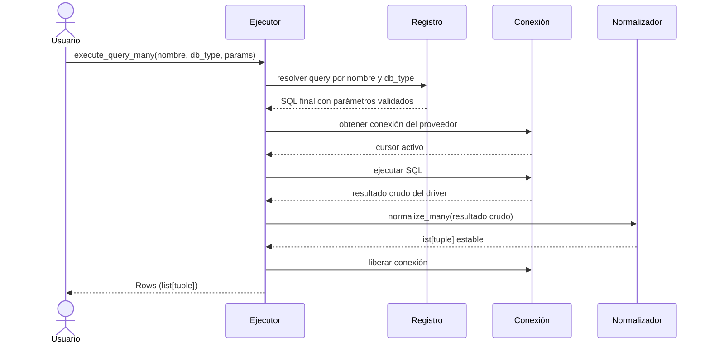

# Ejecución de Consultas

## Objetivo de negocio

Permite lanzar consultas SQL sobre cualquier motor soportado (MariaDB, PostgreSQL, Oracle,
SQLite, SQL Server, HSQLDB) sin gestionar manualmente la conexión, el cursor ni la conversión
del resultado. El consumidor elige entre ejecutar una consulta registrada por nombre o un SQL
libre, y obtiene siempre un resultado normalizado en tipos estables.

Cubre tanto flujos síncronos (aplicaciones estándar, scripts, tests) como asíncronos
(servidores web, pipelines concurrentes).

## Precondiciones

- Un `SyncDatabaseManager` o `AsyncDatabaseManager` configurado y conectado.
- Para consultas por nombre: al menos una query registrada en `QueryRegistry`.
- Los parámetros deben ser `dict[str, Any]` o `None`; no se aceptan listas posicionales.
- Timeout expresado en segundos como `float`, o `None` para sin límite.

## Flujo principal del usuario



## Reglas de negocio críticas

| Regla | Descripción | Impacto si se viola |
|---|---|---|
| Queries por nombre requieren registro | `execute_query_*` solo funciona si la query está en `QueryRegistry` | `QueryNotFoundError` en tiempo de ejecución |
| SQL libre no pasa por validación de registro | `execute_custom_*` acepta cualquier SQL; la corrección es responsabilidad del llamante | Errores de sintaxis o riesgo de inyección SQL |
| El resultado siempre es `Row` o `list[Row]` | Independientemente del driver, el normalizador convierte a `tuple` estable | Código frágil si se accede por índice de columna sin normalización |
| Timeout genera excepción | Si se supera el tiempo configurado se levanta `QueryTimeoutError` | Conexiones colgadas si no se gestiona la excepción |
| Conexión siempre se libera | El ejecutor libera la conexión incluso si hay excepción | Agotamiento del pool si se instancia el ejecutor directamente sin liberación |

## Ejemplo de funcionamiento

```python
from util_bbdd import SyncDatabaseManager
from util_bbdd.executors import SyncQueryExecutor
from util_bbdd.query import QueryRegistry

# Registro de queries nombradas
registry = QueryRegistry()
registry.register(
    "get_usuarios_activos",
    {"sqlite": "SELECT id, nombre FROM usuarios WHERE activo = :activo"},
)

# Creación del ejecutor
executor = SyncQueryExecutor(
    connection_provider=manager.get_connection,
    connection_releaser=manager.release_connection,
    registry=registry,
)

# Consulta por nombre (requiere registro)
filas = executor.execute_query_many(
    "get_usuarios_activos", "sqlite", {"activo": 1}
)
# filas → [(1, "Ana"), (2, "Luis"), ...]

# Consulta libre con timeout
fila = executor.execute_custom_one(
    "SELECT COUNT(*) FROM usuarios",
    timeout=5.0,
)
# fila → (42,)
```

## Límites y exclusiones

- No gestiona transacciones, commits ni rollbacks; eso corresponde al gestor de BD.
- No valida el SQL de consultas libres (`execute_custom_*`).
- No soporta ejecución batch (múltiples sentencias en un solo llamado).
- No incluye caché de resultados; cada llamada ejecuta contra la base de datos.
- No transforma tipos de columna (fechas, decimales); el consumidor recibe tipos nativos del driver.
