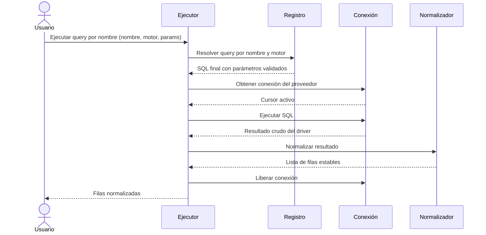

# Ejecución de Consultas

## 1. Descripción General

Permite lanzar consultas SQL sobre cualquier motor soportado (MariaDB, PostgreSQL, Oracle, SQLite, SQL Server, HSQLDB) sin gestionar manualmente la conexión, el cursor ni la conversión del resultado. El consumidor elige entre ejecutar una consulta registrada por nombre o un SQL libre, y obtiene siempre un resultado normalizado en tipos estables.

Cubre tanto flujos síncronos (aplicaciones estándar, scripts, tests) como asíncronos (servidores web, pipelines concurrentes).

**Precondiciones:**

- Un gestor de BD (síncrono o asíncrono) configurado y conectado
- Para consultas por nombre: al menos una query registrada en el registro de queries
- Los parámetros deben ser diccionario clave-valor o nulos; no se aceptan listas posicionales
- Timeout expresado en segundos o nulo para sin límite

## 2. Reglas de Negocio

| Regla | Descripción | Impacto si se viola |
|---|---|---|
| Queries por nombre requieren registro | La ejecución por nombre solo funciona si la query está en el registro | Error de query no encontrada en tiempo de ejecución |
| SQL libre no pasa por validación de registro | La ejecución con SQL libre acepta cualquier SQL; la corrección es responsabilidad del llamante | Errores de sintaxis o riesgo de inyección SQL |
| El resultado siempre es normalizado | Independientemente del driver, el normalizador convierte a tipos estables | Código frágil si se accede por índice de columna sin normalización |
| Timeout genera excepción | Si se supera el tiempo configurado se levanta error de timeout | Conexiones colgadas si no se gestiona la excepción |
| Conexión siempre se libera | El executor libera la conexión incluso si hay excepción | Agotamiento del pool si el executor no gestiona correctamente la liberación |

## 3. Casos de Uso

### Flujo principal

### Flujos alternativos

**Consulta libre:** Con `execute_custom_*` el usuario proporciona el SQL directamente, sin pasar por el registro ni la validación de parámetros. Útil para queries ad-hoc o dinámicas.

**Timeout expirado:** Si la ejecución supera el límite de tiempo configurado, se lanza error de timeout y la conexión se libera igualmente.

**Límites y exclusiones:**

- No gestiona transacciones, commits ni rollbacks; eso corresponde al gestor de BD
- No valida el SQL de consultas libres
- No soporta ejecución batch (múltiples sentencias en un solo llamado)
- No incluye caché de resultados; cada llamada ejecuta contra la base de datos
- No transforma tipos de columna (fechas, decimales); el consumidor recibe tipos nativos del driver

## 4. Glosario y Términos

| Término | Definición |
|---|---|
| Query por nombre | Consulta SQL identificada por una clave string en el registro, en lugar de por su texto SQL literal |
| Query libre | Consulta SQL cuyo texto se proporciona directamente al executor, sin pasar por el registro |
| Normalización | Proceso de convertir el resultado crudo del driver a un formato de filas estable e independiente del motor |
