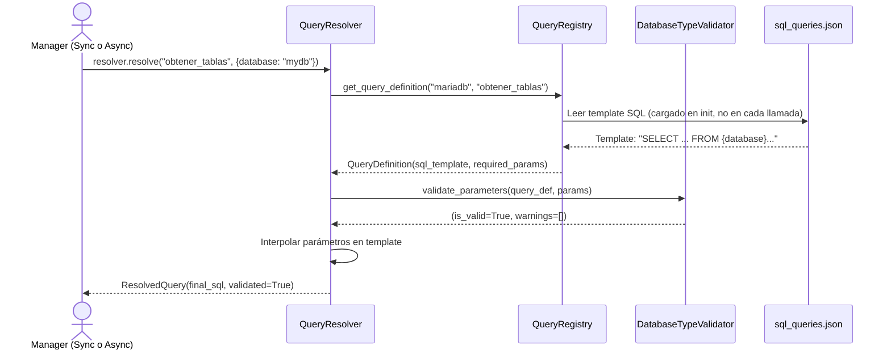

## Objetivo de negocio

Centraliza todas las consultas SQL predefinidas de la librería en un único fichero JSON (`sql_queries.json`), organizadas por motor de base de datos. Cualquier componente que necesite ejecutar una query específica del motor la solicita por nombre; el sistema valida los parámetros y devuelve el SQL final listo para ejecutar, sin exponer el texto SQL en el código de aplicación.

Esto facilita el mantenimiento de queries multi-motor: cambiar la query de PostgreSQL para listar tablas no afecta al código que la invoca, solo al fichero JSON.

## Precondiciones

- Fichero `sql_queries.json` accesible en la ruta por defecto del paquete (`data/sql_queries.json`) o en la ruta personalizada proporcionada
- Tipo de motor declarado y reconocido por la librería
- Parámetros necesarios para la query conocidos por el llamador

## Flujo principal del usuario

## Reglas de negocio críticas

| Regla | Descripción | Impacto si se viola |
|---|---|---|
| Carga única en init | `QueryRegistry` carga el JSON completo al inicializarse; no recarga durante la sesión | Cambios al JSON en tiempo de ejecución no se reflejan sin reiniciar el registry |
| Queries por motor | Cada query está definida bajo su clave de motor (`mariadb`, `postgresql`, etc.); no hay queries genéricas | Solicitar una query para un motor que no la tiene lanza `QueryNotFoundError` |
| Validación antes de interpolación | `QueryResolver` valida parámetros con el `DatabaseTypeValidator` del motor antes de construir el SQL | Parámetros faltantes o incorrectos se detectan antes de ir a BD; el error es claro y tiene contexto |
| Sin excepciones en validadores | Los `DatabaseTypeValidator` deben retornar `(False, [mensaje])` en lugar de lanzar excepciones | Un validador que lanza excepción rompe el flujo del resolver sin mensaje de error útil |
| Interpolación segura | Los parámetros se interpolan directamente en el template (no son bind parameters): solo deben ser identificadores, no valores de datos de usuario | Usar parámetros de usuario en templates SQL sin sanitizar introduce riesgo de inyección SQL |

## Límites y exclusiones

- No ejecuta las queries: solo resuelve el SQL final; la ejecución es responsabilidad del executor del manager
- No cachea queries resueltas: cada llamada a `resolve()` valida e interpola de nuevo
- No soporta queries dinámicas (construcción condicional de cláusulas WHERE): los templates son estáticos con placeholders fijos
- Los parámetros interpolados son identificadores (nombres de base de datos, tabla), no valores de datos: para valores de usuario usar `execute_custom_many` con parámetros bind de SQLAlchemy
