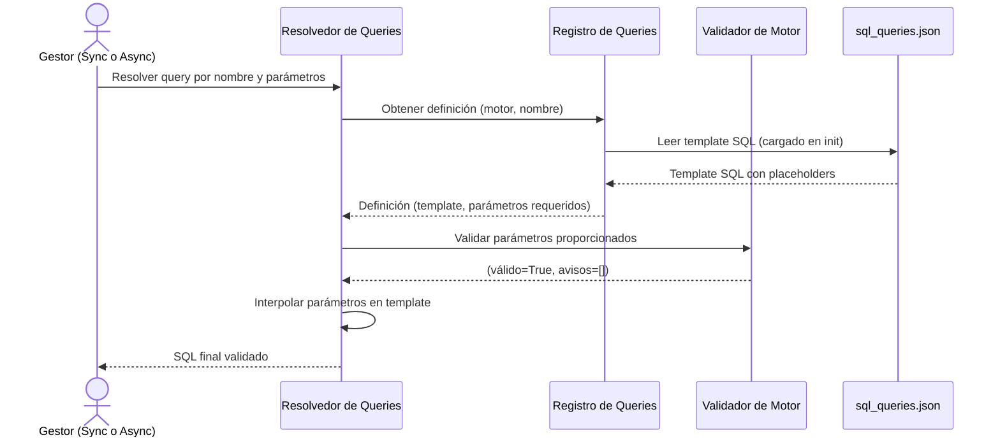

# Registro de Queries

## 1. Descripción General

Permite registrar consultas SQL propias en un fichero JSON organizado por motor de base de datos y ejecutarlas por nombre (`execute_query_many` / `execute_query_one`); el sistema valida los parámetros y devuelve el SQL final listo para ejecutar, sin exponer el texto SQL en el código de aplicación. Desde E2 de ADR-003 la librería no trae consultas propias (`data/sql_queries.json` está vacío por motor): los metadatos se leen con `get_schema_metadata()` y los `get_*` del manager.

Esto facilita el mantenimiento de queries multi-motor: cambiar la query de PostgreSQL para listar tablas no afecta al código que la invoca, solo al fichero JSON.

**Precondiciones:**

- Fichero de consultas propio pasado como `queries_file` al manager (el del paquete, `data/sql_queries.json`, no tiene consultas)
- Tipo de motor declarado y reconocido por la librería
- Parámetros necesarios para la query conocidos por el llamador

## 2. Reglas de Negocio

| Regla | Descripción | Impacto si se viola |
|---|---|---|
| Carga única en init | El registro carga el JSON completo al inicializarse; no recarga durante la sesión | Cambios al JSON en tiempo de ejecución no se reflejan sin reiniciar el registro |
| Queries por motor | Cada query está definida bajo su clave de motor; no hay queries genéricas | Solicitar una query para un motor que no la tiene lanza error de query no encontrada |
| Validación antes de interpolación | Los parámetros se validan antes de construir el SQL | Parámetros faltantes o incorrectos se detectan antes de ir a BD; el error es claro y tiene contexto |
| Sin excepciones en validadores | Los validadores retornan `(False, [mensaje])` en lugar de lanzar excepciones | Un validador que lanza excepción rompe el flujo del resolver sin mensaje útil |
| Interpolación segura | Los parámetros son identificadores (nombres de BD, tabla), no valores de datos de usuario | Usar parámetros de usuario en templates SQL sin sanitizar introduce riesgo de inyección SQL |

## 3. Casos de Uso

### Flujo principal

### Flujos alternativos

**Query no encontrada:** Si se solicita una query para un motor que no la tiene definida, el resolvedor devuelve un error claro indicando el nombre y el motor buscados.

**Parámetros inválidos:** El validador devuelve `(False, [lista de avisos])` en lugar de lanzar excepción, y el resolvedor bloquea la ejecución con `QueryValidationError`. Con `(True, [avisos])` la query se resuelve y los avisos quedan en el resultado.

**Límites y exclusiones:**

- No ejecuta las queries: solo resuelve el SQL final; la ejecución es responsabilidad del executor del gestor
- No cachea queries resueltas: cada llamada valida e interpola de nuevo
- No soporta queries dinámicas (construcción condicional de cláusulas WHERE): los templates son estáticos con placeholders fijos
- Los parámetros interpolados son identificadores, no valores de datos: para valores de usuario usar consultas libres con parámetros bind de SQLAlchemy

## 4. Glosario y Términos

| Término | Definición |
|---|---|
| Template SQL | Texto SQL almacenado en `sql_queries.json` con placeholders para parámetros, por ejemplo `{database}` |
| Interpolación | Proceso de sustituir los placeholders del template por los valores reales de los parámetros |
| Query por nombre | Consulta SQL identificada por una clave string (`"clientes_activos"`) en lugar de por su texto SQL literal |
