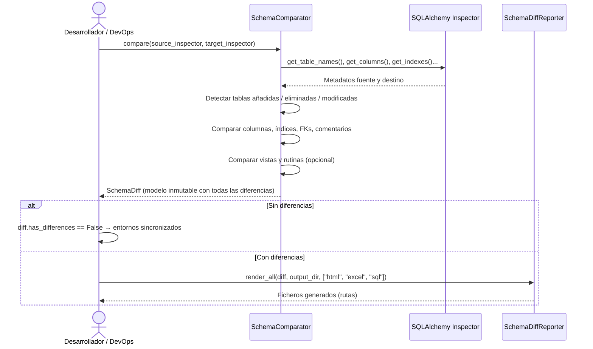

## Objetivo de negocio

Permite detectar automáticamente las diferencias estructurales entre dos bases de datos — tablas, columnas, índices, claves foráneas, vistas, rutinas y comentarios — sin escribir SQL específico para cada motor. El resultado se puede exportar en cinco formatos (HTML interactivo, Excel, Word, Markdown y script SQL de nivelación) para facilitar revisiones de arquitectura, auditorías de migración y sincronización de entornos.

Es el componente que responde a la pregunta "¿qué ha cambiado entre producción y desarrollo?" de forma objetiva y reproducible.

## Precondiciones

- Dos conexiones activas a las bases de datos a comparar (origen y destino), accesibles vía SQLAlchemy `Inspector`
- Permisos de lectura sobre los metadatos del esquema en ambas bases de datos
- Para comparar rutinas (`include_routines=True`): permisos adicionales sobre catálogos del sistema (ej. `pg_proc`, `ALL_PROCEDURES`, `sys.procedures`)
- Para exportar a Word: `python-docx` instalado; a Excel: `openpyxl`; a HTML: `Jinja2`
- Para generar script SQL: conocer el dialecto destino (MariaDB, MySQL, PostgreSQL, SQL Server, Oracle, SQLite o genérico)
- Oracle: parámetro `schema` obligatorio para comparar rutinas

## Flujo principal del usuario

## Reglas de negocio críticas

| Regla | Descripción | Impacto si se viola |
|---|---|---|
| Comparación estructural, no de datos | Solo se comparan definiciones del esquema, no filas ni contenidos de tablas | El resultado no refleja diferencias en datos de negocio |
| Resultado inmutable | `SchemaDiff` y todos sus modelos internos son objetos congelados (`frozen=True`) | Imposible modificar el resultado tras la comparación; crear una nueva comparación si se necesita actualizar |
| Normalización DDL para vistas | El DDL de vistas se normaliza (eliminando DEFINER, ALGORITHM, artefactos motor-específicos) antes de comparar | Diferencias puramente de decoradores no generan `ViewDiff`; solo diferencias semánticas |
| Rutinas deshabilitadas por defecto | `include_routines=False` en `compare()`; habilitarlas en esquemas grandes puede multiplicar las queries al sistema | Habilitar solo cuando realmente se necesite comparar procedures/funciones |
| HSQLDB sin rutinas | HSQLDB no expone DDL portable de rutinas; la comparación retorna lista vacía sin error | No indica que no hay rutinas; indica que no se pueden comparar con este motor |
| Índices sin nombre ignorados | Índices anónimos no se incluyen en la comparación | Puede haber diferencias de índices en BD que no se detecten si no tienen nombre |

## Límites y exclusiones

- No modifica ninguna base de datos: solo lectura del esquema
- No aplica el script SQL de nivelación generado: el desarrollador debe revisar y ejecutar manualmente
- No detecta diferencias en datos de las tablas (solo estructura)
- No compara permisos de usuario ni roles
- No compara datos de configuración del motor (parámetros del servidor, variables de sesión)
- La comparación de comentarios solo cubre columnas comunes a ambos esquemas; comentarios de columnas eliminadas no se detectan
