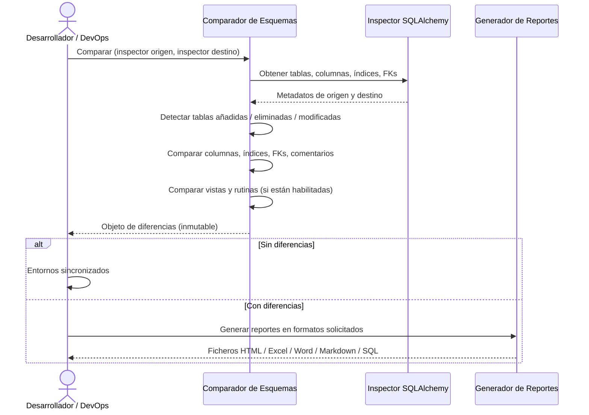

# Comparador de Esquemas

## 1. Descripción General

Permite detectar automáticamente las diferencias estructurales entre dos bases de datos — tablas, columnas, índices, claves foráneas, vistas, rutinas y comentarios — sin escribir SQL específico para cada motor. El resultado se puede exportar en cinco formatos (HTML interactivo, Excel, Word, Markdown y script SQL de nivelación) para facilitar revisiones de arquitectura, auditorías de migración y sincronización de entornos.

Es el componente que responde a la pregunta "¿qué ha cambiado entre producción y desarrollo?" de forma objetiva y reproducible.

**Precondiciones:**

- Dos conexiones activas a las bases de datos a comparar (origen y destino), accesibles vía SQLAlchemy Inspector
- Permisos de lectura sobre los metadatos del esquema en ambas bases de datos
- Para comparar rutinas: permisos adicionales sobre catálogos del sistema
- Para exportar a Word: `python-docx` instalado; a Excel: `openpyxl`; a HTML: `Jinja2`
- Para generar script SQL: conocer el dialecto destino (MariaDB, MySQL, PostgreSQL, SQL Server, Oracle, SQLite o genérico)
- Oracle: parámetro `schema` obligatorio para comparar rutinas

## 2. Reglas de Negocio

| Regla | Descripción | Impacto si se viola |
|---|---|---|
| Comparación estructural, no de datos | Solo se comparan definiciones del esquema, no filas ni contenidos de tablas | El resultado no refleja diferencias en datos de negocio |
| Resultado inmutable | El objeto de diferencias es inmutable una vez generado | Imposible modificar el resultado tras la comparación; crear una nueva comparación si se necesita actualizar |
| Normalización DDL para vistas | El DDL de vistas se normaliza antes de comparar (elimina artefactos motor-específicos) | Diferencias puramente de decoradores no generan vista diferente; solo diferencias semánticas |
| Rutinas deshabilitadas por defecto | La comparación de rutinas no se activa por defecto (`include_routines=False`); al activarla se leen con una consulta por lado | Activarla cuando se necesite comparar procedures/funciones; en Oracle exige `schema` |
| HSQLDB sin rutinas | HSQLDB no expone DDL portable de rutinas; la comparación retorna lista vacía sin error | No indica ausencia de rutinas; indica que no se pueden comparar con este motor |
| Índices sin nombre ignorados | Índices anónimos no se incluyen en la comparación | Puede haber diferencias de índices en BD que no se detecten si no tienen nombre |

## 3. Casos de Uso

### Flujo principal

### Flujos alternativos

**Sin diferencias:** Si ambos esquemas son idénticos, el objeto resultado lo indica y no es necesario generar reportes.

**Exportación selectiva:** Se puede generar solo el script SQL de nivelación (sin HTML ni Excel) cuando el objetivo es únicamente obtener el DDL para sincronizar entornos.

**Límites y exclusiones:**

- No modifica ninguna base de datos: solo lectura del esquema
- No aplica el script SQL de nivelación generado: el desarrollador debe revisar y ejecutar manualmente
- No detecta diferencias en datos de las tablas (solo estructura)
- No compara permisos de usuario ni roles
- La comparación de comentarios solo cubre columnas comunes a ambos esquemas

## 4. Glosario y Términos

| Término | Definición |
|---|---|
| Script de nivelación | Fichero SQL generado que contiene las sentencias DDL necesarias para hacer que el esquema destino sea igual al origen |
| Inspector | Componente de SQLAlchemy que interroga la base de datos sobre su estructura sin ejecutar queries de datos |
| Diferencia estructural | Discrepancia en la definición de tablas, columnas, índices, claves foráneas, vistas o rutinas entre dos esquemas |
