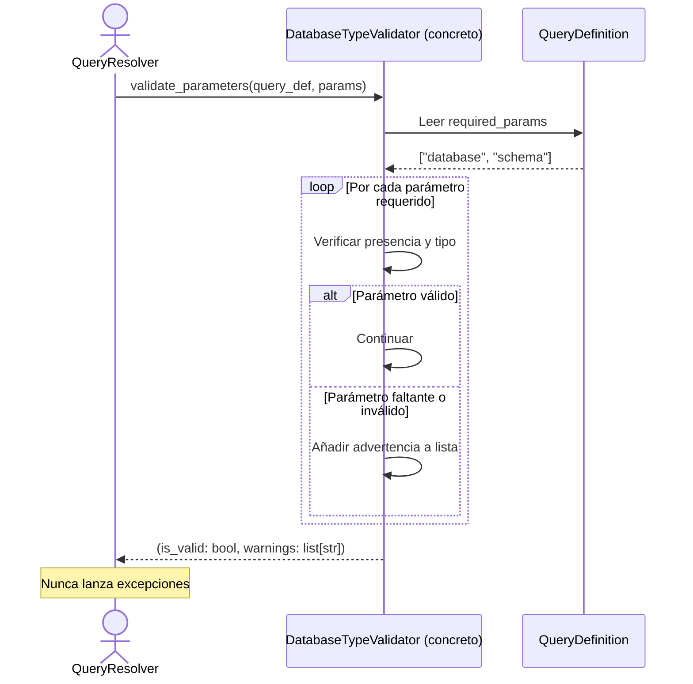

## Objetivo de negocio

Define el contrato que deben cumplir todos los validadores de parámetros de la librería. Cada motor de base de datos soportado tiene reglas propias sobre qué parámetros son válidos para cada tipo de query; el patrón de validador garantiza que esas reglas se aplican de forma consistente y que los errores se comunican de manera uniforme, sin lanzar excepciones inesperadas que interrumpan flujos de resolución de queries.

El resultado es que cualquier componente que use el sistema de queries recibe una respuesta clara: la validación es correcta o hay advertencias, siempre en el mismo formato.

## Precondiciones

- Tipo de motor conocido y mapeado a su validador concreto (MariaDB, Oracle, PostgreSQL, HSQLDB, SQL Server, SQLite)
- Definición de query disponible (`QueryDefinition`) con los parámetros requeridos declarados
- Parámetros proporcionados por el llamador en forma de diccionario

## Flujo principal del usuario

## Reglas de negocio críticas

| Regla | Descripción | Impacto si se viola |
|---|---|---|
| Sin excepciones | Los validadores deben retornar siempre `(bool, list[str])`, nunca lanzar excepciones | Una excepción en `validate_parameters` rompe el `QueryResolver` sin mensaje de error útil para el llamador |
| Advertencias, no errores fatales | Los problemas se acumulan en la lista de advertencias; el llamador decide si bloquear o continuar con avisos | Permite validaciones permisivas en contextos de compatibilidad o migración sin romper el flujo |
| Un validador por motor | Cada motor tiene su clase concreta de `DatabaseTypeValidator` registrada; no se comparte lógica entre motores distintos | Reglas específicas de un motor (ej.: Oracle requiere `schema`) no contaminen la validación de otros motores |
| Interfaz abstracta | `DatabaseTypeValidator` es ABC con `validate_parameters` como método abstracto | Cualquier subclase sin implementar el método lanzará `TypeError` al instanciarse, no en tiempo de ejecución de la validación |

## Límites y exclusiones

- No valida el SQL generado ni su sintaxis: solo valida los parámetros de entrada
- No valida contra el estado real de la base de datos (que la tabla exista, que el usuario tenga permisos): eso ocurre en la ejecución
- El patrón solo cubre validación de queries predefinidas del registry; las queries libres (`execute_custom_*`) no pasan por este sistema
- No es el punto de validación del tipo de motor: eso lo hace `DatabaseTypeValidator` en el nivel del manager, no aquí
