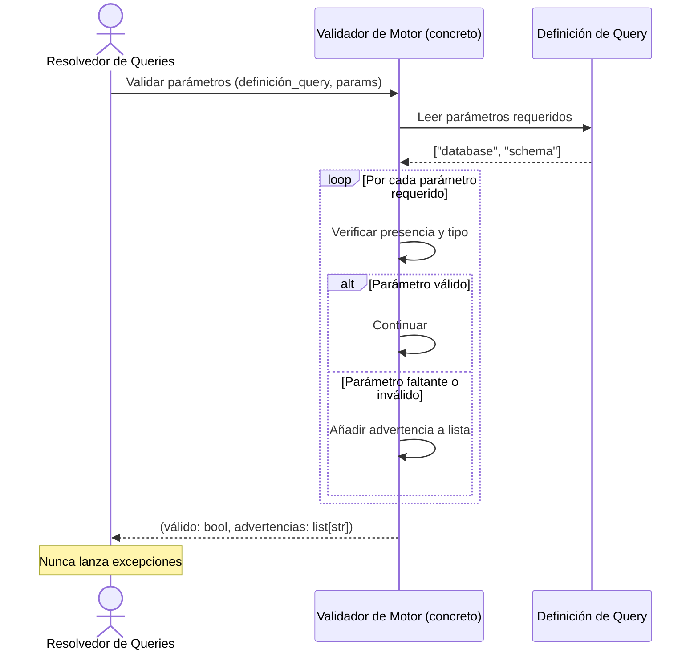

# Patrón de Validadores

## 1. Descripción General

Define el contrato que deben cumplir todos los validadores de parámetros de la librería. Cada motor de base de datos soportado tiene reglas propias sobre qué parámetros son válidos para cada tipo de query; el patrón de validador garantiza que esas reglas se aplican de forma consistente y que los errores se comunican de manera uniforme, sin lanzar excepciones inesperadas que interrumpan flujos de resolución de queries.

El resultado es que cualquier componente que use el sistema de queries recibe una respuesta clara: la validación es correcta o hay advertencias, siempre en el mismo formato.

**Precondiciones:**

- Tipo de motor conocido y mapeado a su validador concreto (MariaDB, MySQL, Oracle, PostgreSQL, HSQLDB, SQL Server, SQLite)
- Definición de query disponible con los parámetros requeridos declarados
- Parámetros proporcionados por el llamador en forma de diccionario

## 2. Reglas de Negocio

| Regla | Descripción | Impacto si se viola |
|---|---|---|
| Sin excepciones | Los validadores deben retornar siempre `(bool, list[str])`, nunca lanzar excepciones | Una excepción en la validación rompe el resolvedor de queries sin mensaje útil para el llamador |
| Resultado, no excepción | Los problemas se acumulan en la lista de mensajes junto a un `bool`; el resolvedor de queries bloquea con `QueryValidationError` si es `False` y deja pasar los avisos si es `True` | Quien llama al validador directamente decide qué hacer con `(False, avisos)` |
| Un validador por motor | Cada motor tiene su clase concreta registrada; las comprobaciones comunes (parámetros requeridos, identificadores) están en la clase base y MySQL reutiliza el de MariaDB | Reglas específicas de un motor (ej.: Oracle valida `esquema`/`schema` como identificador) no contaminan la validación de otros |
| Interfaz abstracta | El validador base define el método como abstracto | Cualquier subclase sin implementar el método lanzará error al instanciarse, no en tiempo de validación |

## 3. Casos de Uso

### Flujo principal

### Flujos alternativos

**Validación directa:** Quien usa un validador fuera del resolvedor (por ejemplo, para comprobar parámetros antes de construir una query) recibe `(False, [avisos])` y decide si continuar; dentro del resolvedor, `False` bloquea la ejecución.

**Motor sin validador registrado:** Si se solicita un validador para un motor no registrado, `get_type_validator` lanza `ValueError` antes de llegar a la validación de parámetros.

**Límites y exclusiones:**

- No valida el SQL generado ni su sintaxis: solo valida los parámetros de entrada
- No valida contra el estado real de la base de datos (que la tabla exista, que el usuario tenga permisos): eso ocurre en la ejecución
- Solo cubre validación de queries predefinidas del registro; las queries libres no pasan por este sistema
- No es el punto de validación del tipo de motor: eso lo hace el gestor, no el validador de queries

## 4. Criterios de Aceptación

Derivados de los tests de los validadores.

| ID | Dado | Cuando | Entonces |
|---|---|---|---|
| AC-01 | Una query con un parámetro obligatorio | Se valida sin ese parámetro | Devuelve `False` y al menos un mensaje, sin lanzar excepción |
| AC-02 | Un identificador con SQL inyectado en `tabla`, `rutina`, `tipo_rutina`, `tablespace` o, en MariaDB y PostgreSQL, `database` | Se valida | Devuelve `False` con mensajes |
| AC-03 | Un identificador legítimo (`CORE_USUARIOS_2024`) | Se valida en cualquier motor | Devuelve `True` |
| AC-04 | Un schema de Oracle de 31 caracteres | Se valida | Devuelve `False` (límite de 30) |
| AC-05 | Un tipo de motor | Se pide su validador | Se obtiene el validador de ese motor, sin distinguir mayúsculas |
| AC-06 | Un tipo de motor no soportado o vacío | Se pide su validador | Se rechaza con `ValueError` |

## 5. Glosario y Términos

| Término | Definición |
|---|---|
| Validador de motor | Clase concreta que implementa las reglas de validación de parámetros específicas de un motor de base de datos |
| Advertencia de validación | Mensaje descriptivo devuelto cuando un parámetro no cumple una regla; no interrumpe el flujo sino que informa al llamador |
| Interfaz abstracta | Contrato (clase base) que define qué método debe implementar cada validador concreto sin proporcionar implementación |
